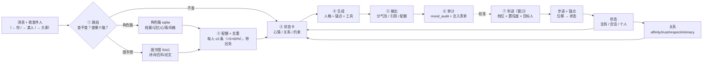

# 设计主文档 v2

> 状态：**v2 设计稿（2026-11-25）**。本文混有三种状态，读时先看 §0.1：
> `【设计】` = 目标、还没写代码；`【已决】` = ADR 已拍板；`【已接线】` = 代码已在跑。
> **不要假设「文档写了」= 「代码在跑」**；接线状态以 §0.1 和 `tuning.UNWIRED` 为准。
> 重写原则：**按会话记录重建，不保留补丁**。旧文档里互相冲突的数字，以本文 §3「口径表」为唯一准。
> 阅读路线：§0 结论 → §0.1 状态 → §1 一张图 → §3 口径表 → §4 决策记录 → 对应子文档。

---

## 0. 结论（三句话）

1. **事件不切，窗口归因**：群聊里 8 句一个窗口，判「谁让她的状态往哪动了多少」，不追求事件起止。
2. **LLM 只报档位，代码做步进**：LLM 给 `impact/arousal/confidence/目标人`，代码查表得相对位移，**置信加权步进**推进状态；每 20 轮补一次**绝对锚点**纠偏。**只有这一条更新链路。**
3. **取数分两个脑**：角色脑（本地 sqlite，毫秒）+ 图书馆（RAG，秒级），中间路由；上下文有硬预算，不堆垃圾。

### 0.1 接线状态（2026-11-25，代码为准）

| 模块 | 状态 | 证据 |
|---|---|---|
| 判读窗口 8 条 / 5min | **【已接线】** | `mood_judge.split_windows` + `judge_and_store(records=)` |
| a/d（唤醒/掌控） | **【已接线】只记录** | `mood.update_ad`；不进 `v`/`chatty`，但进状态卡 |
| 检索规划器 P4 | **【已接线】默认后端仍是 json（可切 sqlite）** | `memdb.recall_planned`；`MEMORY_BACKEND=sqlite` 才生效 |
| 主动节奏 rhythm | **【已接线】** | `proactive._rhythm` |
| `v` 步进 + 锚点 | **【已接线】** | `mood.observe` / `mood.anchor`；`MOOD_UPDATE=v2`（回滚 `=delta`） |
| 判读 schema（impact/target） | **【已接线】** | `mood_judge.judge` 输出 `impact/anchor_level/relation_*` |
| 快速通道护栏 | **【已删除 2026-11-25】** | 拿对方的话猜她的心情；心情只来自她的 `[[THINK]]`（ADR-038） |
| 关系四量 | **【已接线】** | trust/respect 在 `services/relationship.py`；affinity 衰减在 `profiles.decay_affinity`；intimacy 派生 |
| 上下文预算 | **【已接线】已按线上块长校准** | 15 个块级 `CTX_*` 进 `services/ctx_budget.py`；默认值已按真实块长（字符/1.5）校准，`CTX_ENFORCE=1` 只裁异常膨胀 |
| 收发件人阈值 | **【已接线】** | `ADDR_*` → `group_scene._infer_addressee` / 展示三档 |
| 检索 top-k / 多样性 | **【已接线】** | `RET_EVIDENCE_MAX/MEMORY_TOP/MAX_PER_PERSON/SAME_PERSON_RATIO/NEUTRAL_QUOTA/CHAR_LATENCY_MS` |
| 检索二期（倒 U / τ_kind / MMR） | **【已接线】** | `memdb.salience_weight/tau_days` + `services/mmr.py`；`MEM_*` |
| 注意力位置指标 | **【已接线】** | `scripts/eval_gold.py --stage position` + `scripts/position_report.py`（`gold_position` / `lost_in_middle`） |
| p95 周报 | **【已接线】** | `reply_pipeline` 落 `data/metrics/pipeline_stages.jsonl`；`scripts/p95_report.py` + 周报第七节 |
| 输出气泡 40 字 / 2 泡 | **【已接线】** | `OUT_BUBBLE_CHARS` / `OUT_BUBBLES_MAX`（超 2 泡合并转发，不截断） |
| 运行档位（full/eco） | **【已接线】** | `config.POWER_MODE` + `power_on()`；与 `GROUP_WATCH_MODE` 正交 |
| 长答 long_doc | **【已接线】** | `llm.is_long_doc` + `LONG_DOC_*`；单轮放开 token/证据，气泡上限豁免 |
| 工具检索 top6 | **【已接线】** | `llm.tools_for(key, text)` + `RET_TOOLS_TOP`（send/stay_silent 必留） |
| 收发件人归因 | **【已接线】仅高置信** | `mood_judge.resolve_target` + `[ADDR]`；conf≥`ADDR_ASSERT_MIN` 才改归属 |
| 互动边 `interaction_edges` | **【已接线】** | `memdb.note_edge` + `[EDGE]`；只记高置信「谁 → 谁」 |
| 记忆双写 json→sqlite | **【已接线】默认开** | `memory_v2._dual_mirror` + `[MEM] dual-write`；`MEMORY_DUAL_WRITE=0` 关 |
| 风格 custom 层 | **【已接线】** | `style_vault.submit/approve` + `white_moon.render`；≤`CTX_CUSTOM` 字，优先于 samples |
| 白月光借风格护栏 | **【已接线】** | `WHITE_MOON_BORROW/RATIO` + `PERSONA_EXPRESSIVENESS`；默认 0，只给 1 行事实 |
| profiles/style_samples/threads | **【已接线】** | `memdb.upsert_profile/add_style_sample/upsert_thread` + `[MEM] … sync` |
| 主动闭环 accept_rate | **【已接线】** | `proactive.note_reply/accept_rate`；回话窗口 `PROACTIVE_ACCEPT_WINDOW_H` |
| 群主动日上限 | **【已接线】** | `PROACTIVE_GROUP_MAX_PER_DAY=3` + `[PROACTIVE] 群 … 今天主动 N 次` |
| 人设底色 | **【已接线】** | `services/persona_traits.py`：warmth/forgiveness/trust_speed/reactivity/sensitivity |
| prompt 单入口去重 | **【已接线】** | `_staged` 存在时跳过 focus / 白月光重复注入（ADR-020） |

> 这张表就是「文档 vs 代码」的唯一对照。**表里写【设计】的，代码没跑；不要拿 §3 的数字去调线上。**
> `tuning.UNWIRED` 已清空：所有设计键都有真实读点。
> `RET_LIB_LATENCY_MS` 是图书馆延迟告警阈值；`RET_STYLE_TOP` 控制白月光注入几句原话；
> `RET_WORLD_TOP` 控制图书馆候选池条数；`RET_FUSION_RRF=1` 可开多路 RRF。
> 线上验证方法见 [verification-runbook.md](verification-runbook.md)。

---

## 1. 一张图



八段：**接入 → 收发件人 → 该不该回 → 队列 → 路由取数 → 状态卡/生成 → 输出 → 判读/审计**。
和旧版的区别：收发件人、配额、审计全部画进来了；工具走单独车道（不取记忆/图书馆）；
判读在生成之后，但会写回下一轮的状态（ADR-013）。详见 [pipeline-map.md](pipeline-map.md) §8。

---

## 2. 文档地图

| 文档 | 回答什么 | 不回答什么 |
|---|---|---|
| **DESIGN.md（本文）** | 全局怎么串、口径是什么、决策是什么 | 具体公式推导 |
| [addressing-design.md](addressing-design.md) | 「谁 → 谁」怎么判、置信度、怎么用于归因/关系/记忆 | 状态公式 |
| [emotion-dynamics-design.md](emotion-dynamics-design.md) | 心情怎么更新、关系怎么涨/怎么衰减、人设怎么量化、安静/主动 | 检索实现 |
| [retrieval-design.md](retrieval-design.md) | sqlite 怎么建、时间/情绪怎么优先、关键词工程、和 RAG 怎么分 | 情绪公式 |
| [style-white-moon-design.md](style-white-moon-design.md) | 风格四层、白月光定位、注意力额度、借风格护栏 | 情绪公式 |
| [emotion-annotation-spec.md](emotion-annotation-spec.md) | 200 条情绪标注怎么抽/怎么标/怎么算一致率 | 代码实现 |
| [attention-design.md](attention-design.md) | 给多少、怎么排、引用怎么当锚点、成本怎么控 | 检索算法 |
| [prompt-skeleton-design.md](prompt-skeleton-design.md) | 各块的最终文本、空块规则、证据/anchor/分气泡结构 | 取数逻辑 |
| [proactive-design.md](proactive-design.md) | 主动接话 / 主动私聊：按心情+好感驱动的自驱车道 | 回复道细节 |
| [pipeline-map.md](pipeline-map.md) | 一条消息经过哪些阶段、还剩哪些缺陷 | 参数细节 |
| [design-foundations.md](design-foundations.md) | 为什么这么设计、参考什么、闭环还差什么 | 实现步骤 |
| [causal-assertions.md](causal-assertions.md) | 33 条可证伪断言：怎么判断「系统真的按设计在动」 | 实现细节 |
| [tuning-guide.md](tuning-guide.md) | 使用者怎么调参：改哪个键、安全范围、怎么验证 | 设计推导 |
| [design-audit-2026-11-25.md](design-audit-2026-11-25.md) | 历史文档 vs v2：矛盾 / 漏看 / 该归档 | 最终决策 |

> 已删除的旧内容：`retrieval` 里「金标准谁出题」、`foundations` 里与现设计冲突的 C1~C9 原文（只保留状态表）。
> `pipeline` 的 D 表以 `pipeline-map.md` 为准；本文不再声称某条 D 已修。

---

## 3. 口径表（唯一准，所有文档引用这里）

### 3.1 心情（VAD）

> **量纲（先看这条）**：所有公式（`step / saturation / P / R / Q / anchor`）一律在
> **归一化空间 `v ∈ [-1, +1]`** 计算；落盘/展示时 ×100（内部 -100~100，见 [tuning.md](tuning.md)）。
> `mood_audit` 记**归一化值**。别把 `abs(v)=32` 直接代进 `1−0.6×abs(v)`——那会得到负数，Δ 反向。

| 项 | 值 | 说明 |
|---|---|---|
| `v` 效价 | `-1 ~ +1` | 难受 ↔ 开心 |
| `a` 唤醒 | `0 ~ 1` | 平静 ↔ 上头（**只记录**：置信加权 EMA + 独立衰减，不进 z） |
| `d` 支配 | `0 ~ 1` | 被压着 ↔ 我说了算（同上，不进 z） |
| 半衰期 | 群 **30min** / 私聊 **2h** / 全局 **6h** | 每轮先衰减再步进 |
| 观测档位 | `impact ∈ {-2,-1,0,+1,+2}` | LLM 只报这个 |
| 观测 `z` | `z = clamp(v⁻ + dir×step×sens, −1, +1)` | **伪观测**（不是独立测量）；`z−v⁻` 才是这次位移 |
| 判读窗口 | **8 条** 或 **5min**（`MOOD_WINDOW_MAX_SEC`），先到先判 | 段内按 `msg_ids` 切窗，前面的窗按「旁观」补判；慢群不靠攒满 8 条 |
| 观测步长（名义） | `impact=±1 → 0.10`；`impact=±2 → 0.22` | 代码查表 |
| 实际位移（首条 / 稳态） | 首条 ≈0.085（K≈0.85）；同段第 5 条起 ≈0.02~0.05 | 由 K 与 saturation 决定 |
| 人设敏感度 | `sensitivity ∈ [0.6, 1.4]` | 乘在观测步长上 |
| 饱和 | `Δ × (1 − 0.6×abs(v))` | 越接近 ±1 越难走 |
| 步进硬上限 | `abs(Δv) ≤ 0.35`（护栏；当前参数下最大 ≈0.28，不触发） | **只管步进**；锚点单次 0.20；强负面钳制不受此限（见下行） |
| 不确定度初值 | `P0 = 0.25` | 初始不确定度 |
| 过程噪声 q_rate | `0.02 + 0.10×reactivity`（每小时） | `Q_eff = q_rate × Δt_h`，随 Δt 缩放 |
| 观测噪声 R | `0.02 + 0.60×(1−confidence)²` | 置信低 → 几乎不动 |
| 锚点触发 | 每 **20 个判读窗口** / 静默 **30min** | 按会话计数，不是全局；**已接线**（`mood.anchor`，2026-11-25） |
| 锚点映射 | `level ±2 → ±0.7`、`±1 → ±0.35`，**叠在她本人基线上**：`z_abs = clamp(baseline_v + map(level))` | `level` 是相对基线的档位，不是绝对心情值 |
| 锚点增益 | `K_a = 0.25×confidence`；死区 **0.15**；单次 `|Δ_a| ≤ 0.20`（`MOOD_ANCHOR_MAX_MOVE`） | 一次最多挪「差距的 25%」，再被 0.20 夹住 |
| ~~强负面护栏~~ | **已删除（ADR-038）**：不再按「@她 + 辱骂词」钳 `v` —— 那是拿对方的话猜她的心情 | 没有 THINK 就不改心情；`mood.fast_guard` 函数保留但**无调用** |

### 3.2 关系（四个量，单位不同）

| 量 | 范围 | 基线 | 半衰期 | 谁改它 |
|---|---|---|---|---|
| `affinity` 好恶 | `-1 ~ +1` | `0` | **7 天 × 深度系数** | 只由 `target ∈ {speaker,recipient,other}` 的事件改 |
| `trust` 信任 | `0 ~ 1` | `0.20` | **45 天** | 只由「可信/失信」事件改 |
| `respect` 尊重 | `0 ~ 1` | `0.30` | **90 天** | 只由「能力/地位」事件改 |
| `intimacy` 亲近 | `0 ~ 1` | `0` | **30 天**（`REL_INTIMACY_HALF_LIFE_DAYS`，as-built 在 `profiles.intimacy()`） | 由相处量 + 情绪 + 时间算 |

深度系数：`τ_eff = 7天 × (1 + 2×intimacy) × (1 + 0.5×近7天互动次数归一化)`。
→ **越亲近，好感掉得越慢**（投资模型）。

> `intimacy` 以**派生量**为准（`bond notes` 的条数/情绪/时间 + affinity 贡献）；
> `emotion §3.1b` 的 `Δintimacy` 只是**写 notes 时的权重建议**，不是第二个状态变量——不要两者同时累加。

> `relation_relevance`：judge 输出 [0,1]；**缺省 0.5 = 「不确定，半信」**。
> 不想给未知事件加好感，就把缺省设 0；`world`/`self` 恒 0（只动心情，不动关系）。
>
> **关系审计现状**（2026-11-25）：
> `affinity` 有 `affinity_log`（最近 50 条：at/delta/to/why）；
> `intimacy` 由 `bond notes` 推导，notes 本身就是输入审计；
> `trust` / `respect` **已实现**：写入口 `relationship.note_judge`（读 judge 的
> `relation.{trust,respect}`，只由关系事件触发，普通闲聊不动），
> 流水 `data/relationship_log.jsonl`，状态卡由 `relationship.render_line` 输出。
> **`affinity` 必须双向**：涨跌同一套步长，对称夹在 ±0.10；负向再乘
> `neg_weight(当前好感)`（越喜欢越宽容）。

### 3.3 上下文预算

> 口径：**单位是汉字/字符，不是 token**。**live 池** = `PROMPT_BUDGET=2200` 字符（`prompt_builder` 实际用的）；
> 本表 2120 是常态目标，**2.7k 是设计上限**——`PROMPT_BUDGET` 调到 2700 才生效。
> 常态 = 单目标 / 无工具意图 / 无 custom；其余场景单列，不再用「2.1k」笼统概括。
> as-built 的分块在 `services/prompt_builder.py::BLOCK_BUDGET`（profiles/mood/relation/quiet/lore…），
> 和本表**不是一一对应**；本表是目标拆分，`check_design_docs` 校验本表，总池由 `PROMPT_BUDGET` 兜底。

| 区 | 上限（字符） |
|---|---|
| persona（她是谁） | 400 |
| expression（她自己的口癖） | 120 |
| 协议 + 状态卡 | 180 + 120 |
| profile（身份/性格/称呼/好感词/印象） | 160 |
| 白月光（档案里 1 行事实） | 40 |
| 群摘要 | 120 |
| 证据（≤5 条） | 500 |
| 历史（≤8 行） | 150 |
| 引用锚点 | 60 |
| 原话样本（3 句） | 150（custom 时替换为 ≤250） |
| 表达节奏（rhythm） | 40 |
| post_rules | 80 |
| 工具（top6） | 300（无工具意图 = 0） |
| 多目标（≥2 人） | 60 |
| 可选块（lore / conv_state / focus / threads） | 从池子里抢，不单列；lore ≤520 |
| **常态合计（单目标 / 无工具 / 无 custom）** | **≈ 2.1k（2120）** |
| 有工具意图 | ≈ 2.4k（2420） |
| custom 替代样本 | ≈ 2.2k（2220） |
| 多目标 | ≈ 2.2k（2180） |
| **硬上限** | **12k（仅 `intent=long_doc` 且用户明确要长答）；否则设计上限 2.7k / live 池 2.2k** |
| long_doc：证据（长文，3 篇 × ≤1900 + 出处 300，替代上面的 500） | 6000 |
| long_doc：图书馆 | 3000（单独给，不含在上面 6000 里） |
| long_doc：其它块 | persona / 协议 / 状态卡 / 历史 / anchor **不变**（不随 long_doc 膨胀） |
| long_doc 合计 | ≈10.6k（2120−500+6000+3000），≤12k |

> **裁剪顺序**（避免「单条上限 > 块上限」）：
> 证据用 `summary`（≤80 字/条），`RECALL_TEXT_MAX=600` 是展开全文、**不进 prompt**；
> anchor 只放 ≤60 字摘要，`QUOTE_MAX_CHARS=500` 是引用解析上限；
> 群摘要块 120 字，`SCENE_SUMMARY_MAX_CHARS=160` / `CONV_STATE_MAX_CHARS=420` 是存储上限；
> 历史只放 8 行，`MAX_GROUP_RECENT=16` / `HISTORY_MAX=20` 是现场缓存；
> persona 400 字是目标，`PERSONA_GROUP_CHARS=0` 表示不按群限制、进 prompt 时仍按 400 裁。

**判读预算**（生成有预算，判读也要有；否则活跃群会线性涨）：

| 项 | 上限 |
|---|---|
| 单窗 | 8 条消息（`MOOD_JUDGE_CTX`） |
| 单段 | ≤5 窗（40/8，段上限天然封顶） |
| 每会话每小时 | ≤30 次（`MOOD_JUDGE_MAX_PER_HOUR`；超了丢掉最早的窗，只判最近几窗） |
| 单窗 token | ≤1.2k（8 条 ×150 + 状态卡 + schema） |
| 锚点 | 每 20 窗 1 次（已接线） |

> **三套口径，别混**（2026-11-25 明确）：
> ① 本表 = **常态目标**，加总用 `design_constants.budget_total()`（2120），`check_design_docs` 校验它；
> ② `tuning.CTX_*` = **运行时单块上限**（合计 4620，`ctx_total()`），只防单块膨胀；
> ③ `PROMPT_BUDGET=2200` 字符 = **live 总池**，`prompt_builder` 真正裁剪用；
> `CTX_ENFORCE=0` 时 ② 只统计不裁剪 —— 那种状态下它叫「观测」，不叫「硬截断」。
> 旧表漏列 profile / rhythm / post_rules / 多目标，所以「2.1k」只在常态口径下成立。
> 风格相关合计（expression + 样本或 custom + rhythm + 白月光）**≤450**，见 [style-white-moon-design.md](style-white-moon-design.md)。

### 3.4 检索

| 项 | 值 |
|---|---|
| 角色脑延迟目标 | ≤50ms |
| 图书馆延迟 | 目标 **3s**｜现状 **10s**｜超时 **14s**（`AGENT_LIBRARY_TIMEOUT`）｜硬 deadline **16s**（`PIPELINE_BUDGET`） |
| 候选池（最终证据 ≤5） | 先取 `RET_PLAN_CAND=400` → 预过滤 **50** → 最终 5；memory 4 / world 3 / profile 2；**style 走自己的 ⑦ 块，不进证据池**；tools 6 单独注入 |
| 证据选法 | 先按人分组，**每人 ≤3 条**（=5×60%）；组内按分数；再跨组取 top5 |
| 反向保底 | top5 全同向时，**替换分数最低的那条**，把最高分的反向/中性条插在第 1 位；无候选则跳过；无 sentiment 视为中性计入 |
| long_doc 判据 | ①「详细讲讲/展开说/写个总结/分析一下」②「这本书/论文/代码讲了什么」→ **单轮长答**（直接分配 6000+3000，不存在「先短后长」）。③「图书馆已返回 ≥3 篇」只用于 ①② 未命中时的补充判定：**不追加第二条回复**，命中结果留给下一轮 `[[LIBRARY]]` |
| 长文模式例外 | long_doc 的 6000 是**证据块**（3 篇 × ≤1900 + 出处 300）；「每人 ≤3 条 / 反向保底」只作用于常态短证据，不适用于长文 |
| RRF `k` | 60 |
| 过滤优先级 | **人 → 时间 → 情绪 → 标签 → 关键词** |

### 3.5 收发件人（详见 addressing）

| 信号 | 置信度 |
|---|---|
| @她 / 引用她 | 0.99 / 0.95 |
| 开头称呼「X，…」 | 0.80 |
| 正文点名 | 0.70 |
| 上一句提问 → 这句回答 | 0.65 |
| 用了「你」（非你们） | 0.60 |
| 反应词/附和相邻 | 0.55 |
| 短句冲最近被提到的人 | 0.50 |
| 无信号 | `unknown` |

展示阈值：`≥0.8` 断言「→ X」；`0.5~0.8` 写「像是在回 X」；`<0.5` 写「不确定」。

**Address → judge `target` 的桥**（`addressing §3.4` 只给 Address，target 由 judge 选）：

| `to_kind` | 默认 `target` | 说明 |
|---|---|---|
| `bot` | `speaker` | 冲她说 |
| `person` | `recipient` | 冲另一个人说 |
| `group` | `world` | 对大家说 |
| `unknown` | judge 决定（缺省 `world`） | conf<0.5 时不要把「不确定」算成 speaker |

### 3.6 口径缺口与定案（G1~G10）

> 这 10 条是「文档已引用、但定义缺失或数值自相矛盾」的地方，**2026-11-25 已全部定案**。
> 口径类由 `scripts/check_design_docs.py` 锁住；语义类见对应 ADR。
> 保留本表是为了记录「为什么当时必须改」，实现时**不要回退**。

| # | 缺口 | 修复前 | 建议 | 不修的后果 |
|---|---|---|---|---|
| G1 | `relation_rel` 未定义 | `emotion §3.2` 公式引用；`retrieval` 建列 `DEFAULT 0` | 改用 judge 的 `relation_relevance`，`DEFAULT 0.5` | **Δaff 恒为 0，好感永不增长** |
| G2 | `intimacy` 无更新式 | 却驱动 `τ_aff`、关系阶段、proactive warm | `Δintimacy = 0.03×(1−i)×depth`，depth 取 0/0.5/1 | 关系系统冻结在初始值 |
| G3 | `z` 定义在预测之上 | `z = v⁻ + dir×step×sens` | ✅ 已定 A+锚点：步进为主，每 20 轮补绝对锚点 | 纯相对会漂；纯绝对会回声 |
| G4 | `Q` 不随 Δt 缩放 | 每次更新加一次 | ✅ `q_rate=0.02+0.10×reactivity`，`Q_eff=q_rate×Δt_h` | 群越热闹越易变 |
| G5 | `max_step` / 硬限幅 0.35 | 实算 `Δ ≤ 0.285`，**永不触发** | ✅ 删 `max_step`；0.35 降为护栏；只留 `saturation` | 三个护栏只有一个真在工作 |
| G6 | `a/d` 无档位→步长表 | 只定义了 `impact` 的步长 | ✅ 一期 `a/d` 只记录、不进 `z`；**2026-11-25 已接线**（`mood.update_ad`，置信加权） | a/d 算不出来（且 clamp 域错） |
| G7 | 快速通道数值无效 | `conf=0.4 → Δ≈0.03` | ✅ 护栏 `v=min(v,−0.45)`（轻负面 −0.25）+ `P×1.5` + 状态卡 | 「刚被骂完还在笑」救不回来 |
| G8 | 12k 无触发条件 | 「仅 mixed + 长文档」 | ✅ 仅 `intent=long_doc` 且用户明确要长答；否则 2.7k | 预算后门 |
| G9 | 20 字 vs 拒绝权 | `§9.1` 按字符，人格按气泡 | ✅ 改按气泡：单泡 ≤40 字、总 ≤2 泡 | 一解释就被塞进合并转发 |
| G10 | 红线 3 vs 关键词路由 | 「不用正则猜语义」但路由/破冰/快速通道都在用词表 | ✅ 改为「规则可**召回**、不可**判决**」+ 快速通道例外 | 实现时不知道听哪条 |

> ✅ **G1~G10 全部定案（2026-11-25）**，见 ADR-026~035。

---

## 4. 决策记录（ADR）

| # | 决策 | 状态 | 理由 |
|---|---|---|---|
| ADR-001 | 不做事件切分，做 8 句窗口冲击归因 | ✅ | 群聊发散，事件边界不可得 |
| ADR-002 | LLM 报档位 + 置信度 + 目标人，不报小数 | ✅ | 语义强、刻度弱 |
| ADR-003 | 状态更新只有一条链路：**置信加权步进**（每轮）+ **周期绝对锚点**（每 20 轮 / 静默 30min） | ✅ | 旧三套公式并存；相对观测不能纠偏，故补锚点 |
| ADR-004 | 事件研究（实际−预期）**二期再做** | 🟡 二期 | 一期先把观测/滤波跑通，避免公式叠加 |
| ADR-005 | 记忆拆 `storage_strength` / `retrieval_strength` | ✅ | 「重要不忘 + 旧事变淡」 |
| ADR-006 | 双脑分离：角色脑 sqlite / 图书馆 RAG | ✅ | 延迟、隐私、更新频率不同 |
| ADR-007 | 全局心情是**独立慢变量**，不由会话均值反推 | ✅ | 旧版循环定义（旧 X5） |
| ADR-008 | 单一状态源（一个写入口，其余只读） | ✅ 已接线 | `mood._serialized` 串行所有写入口 + `_save` 用 flock 保护 tmp→replace；读接口不抢锁 |
| ADR-009 | 评估先行：先检索（0 费用），再生成（预算内） | ✅ | 先有尺子 |
| ADR-010 | 人设底色参数化（sensitivity/warmth/forgiveness/trust_speed/reactivity） | ✅ | 冷漠/热情不能一个系数 |
| ADR-011 | 收发件人是一等公民，参与判读/记忆/关系归因 | ✅ 新增 | 现在只用于展示（旧缺口） |
| ADR-012 | 上下文预算单一口径：常态 ≈2.1~2.2k / 上限 12k | ⚠️ 被 033/039 取代 | 旧版 2.1k 与 12k 混用（旧 X3）；12k 现仅 long_doc |
| ADR-013 | 判读默认晚一轮；强负面消息走**快速通道** | ⚠️ 快速通道被 ADR-038 删除 | 解决「刚被骂完还在笑」（旧 X9）；但它是拿对话猜心情 |
| ADR-014 | 心情检索走结构化 `(about_qq, 方向, 时间)` | ✅ | 实测 BM25 0.33 → 结构化 1.00 |
| ADR-015 | 风格分四层（persona/expression/samples/custom），风格相关 ≤450 token | ✅ | 旧版重复注入 + 1200 字样本挤爆预算 |
| ADR-016 | 白月光 = **关系参照系**，不默认借风格；借需 `borrow_ratio` + 人格护栏 | ✅ | 旧语义会「变成别人」 |
| ADR-017 | 情绪外部效标：200 条标注，50 条双人重叠，impact QWK ≥0.60 | ✅ | 100 条检索集测不了档位 |
| ADR-018 | 自然语言工具请求走**回复道**（模型决定做不做），命令直达工具道 | ✅ | 保留人格与拒绝权 |
| ADR-019 | 任一环节超时 → **用已到的块回复**；慢块后置优化 | ✅ | 不让 6s 总结拖死回复 |
| ADR-020 | prompt 单入口 + 固定顺序 + 空块不出现 + `_staged` 不重复注入 | ✅ | 现在块按调用顺序 append，重复且难查 |
| ADR-021 | 归因用 5 值：`speaker/recipient/other/world/self` | ✅ | 旧 3 值会把「第三个人骂她」记成 world，好感不动 |
| ADR-022 | 表达节奏（旧 attention）并入风格层；不参与心情/关系/记忆数值，仅作自驱强度 ±10% | ✅ | 同名不同物；`off` 不再等于「关掉主动」 |
| ADR-023 | 主动接话/主动私聊 = 独立自驱车道，按心情+好感驱动 | ✅ | 触发条件与回复道不同，混在一起互相干扰 |
| ADR-024 | 记忆「每 turn 都记，Δ 只决定加粗/检索权重」 | ✅ | Δ 不是记录门槛；sqlite 后检索会变，记录语义不变 |
| ADR-025 | 识图：不建本地角色库，云端源+视觉+别名表；只做动漫；算力机异步；**暂缓** | 🟡 暂缓 | bot 无 GPU；本地图库维护成本高；真人脸合规风险 |
| ADR-026 | 好感关系项统一为 `relation_relevance`（judge 输出，`DEFAULT 0.5`） | ✅ | 旧 `relation_rel` 无定义且 DEFAULT 0 → Δaff 恒 0 |
| ADR-027 | `intimacy` 用 depth 增量式（0/0.5/1），**30 天半衰期**；负面事件不直接降 | ✅ | 它驱动 τ_aff/阶段/proactive；不联系会变淡（depenetration） |
| ADR-028 | 删 `max_step`（恒不触发），只留 `saturation`；0.35 降为护栏 | ✅ | 三个护栏里两个是死的 |
| ADR-029 | G3 定为「A+锚点」：相对位移为主，每 20 轮绝对锚点纠偏；锚点判读**不看当前 v** | ✅ | 纯相对会漂、纯绝对会回声 |
| ADR-030 | `Q` 改为速率 `q_rate=0.02+0.10×reactivity`，按 `Δt_h` 缩放 | ✅ | 旧 Q 按「每次更新」累加，活跃群更易变 |
| ADR-031 | `a/d` 一期只记录、不进 `z/Δ` | ✅ | 没有档位→步长映射；clamp 域也不对 |
| ADR-032 | 快速通道改**护栏** `v=min(v,−0.45)`（轻 −0.25）、`P×1.5`，不走步进 | ⚠️ 被 ADR-038 删除 | conf 0.4 时步进只挪 0.03；但护栏仍是在猜她的心情 |
| ADR-033 | 12k 仅在 `intent=long_doc` 且用户明确要长答时启用，否则 2.7k 硬截断 | ✅ | 12k 不能是默认逃生舱 |
| ADR-034 | 输出按**气泡**限：单泡 ≤40 字、单轮 ≤2 泡；超 2 泡才合并转发 | ✅ | 按字符限会把「拒绝+解释」塞进卡片 |
| ADR-035 | 规则可**召回**、不可**判决**；快速通道只做保守钳制 | ✅ | 词表路由与「不用正则猜语义」自相矛盾 |
| ADR-036 | 实现前先有 33 条**因果断言**；断言红了不许改断言，先判「设计错」还是「实现错」 | ✅ | 100 题测入口、200 条测档位，都测不到轨迹 |
| ADR-037 | 锚点计数**包含**被 relevance 跳过的窗口（否则噪声群永不锚定） | ✅ | 低信息群 `P→0` 会冻结状态 |
| ADR-038 | **心情只来自她的 `[[THINK]]`**：没有 THINK 的旁观窗口不写 `v`；删除快速通道；`judge.mind` 降级为猜测 `guess` | ✅ 已接线 | 2026-11-25 用户：「不能拿外界对话猜她的心情；她理解错了是她的事，标签块只管是不是对她说的」 |
| ADR-038 | 证据选法：每人 ≤3 条 + 反向保底；tools 不占证据名额 | ✅ | 纯按分数会 5 条全同一人 |
| ADR-039 | long_doc 只膨胀证据 6000 / 图书馆 3000；人设与现场块不变 | ✅ | 放大 persona 会打掉前缀缓存 |
| ADR-040 | 检索规划器：**结构化过滤在前**（人/时间/情绪/标签），关键词与打分在后；sqlite 后端默认启用 | ✅ | 旧版把时间/情绪当权重，「上周的事」会混进去年（R2） |

---

## 5. 术语（只留最容易混的）

| 术语 | 一句话 |
|---|---|
| **观测 z** | 由 `impact` 查表得到的**绝对伪观测**（`v⁻ + dir×step×sens`）；`z−v⁻` 才是位移，`z` 不是当前心情值 |
| **Δ / Δv** | 本次实际位移 = `K×(z−v)×saturation`；落盘 ×100，公式一律在 `v∈[-1,1]` 算 |
| **步进增益 K** | 这次位移该信几成；置信低 → K 小（沿用卡尔曼的 K 形式） |
| **锚点 z_abs** | 每 20 轮判一次「她整体在哪档」，用来纠偏 |
| **过程噪声 Q** | 她本身多容易变（人设） |
| **观测噪声 R** | 这次判读多不可信（置信度） |
| **存储强度** `storage` | 编码多牢，不衰减；由 `w`（倒 U）+ relation_relevance 算。⚠️ `unexpected` 目前**判读不产出、也没落库**（二期再补），公式里那一项恒 0 |
| **提取强度** `retrieval` | 现在能不能想起，按 `τ_kind` 衰减、被用会变强 |
| **显著性权重** `w` | `u=|ΔVAD|` 的倒 U 函数：小冲击不记、中等最显著、极端回落（emotion §6） |
| **提取时间常数** `τ_kind` | 按记忆 kind 的衰减半衰期（天）：event 30 / bond 90 / preference 180 / fact 365 / style 365 |
| **深度系数** | 越亲近，好感衰减越慢（`τ_aff = 7天 × (1+2×intimacy) × …`） |
| **anchor** | 引用/被 @ 的原消息，结构化后紧贴当前消息 |
| **预过滤** | 先用标签/SQL 把候选从 8000 降到 50，再让模型看 5 条 |

---

## 6. 层 → 代码

| 层 | 文件 |
|---|---|
| 接入 / 收发件人 | `plugins/chat`、`services/segments.py`、`services/group_scene.py` |
| 状态 | `services/mood.py`、`services/mood_judge.py`、`services/profiles.py`、`services/group_mood.py`、`services/quiet_advisor.py` |
| 记忆 / 检索 | `services/memory_v2.py`、`services/memdb.py`、`services/scene_auditor.py` |
| 人格 / 生成 | `services/persona.py`、`services/prompt_builder.py`、`services/llm.py`、`services/aura_logic.py` |
| 规矩 / 自驱 | `services/chat_switch.py`、`services/referee.py`、`services/group_roster.py` |
| 干活的手 | `plugins/draw`、`plugins/song_cover`、`plugins/vision_agent`、`plugins/napcat_tools` |
| 观测 / 评测 | `services/llm_usage.py`、`core/tuning.py`、`scripts/eval_gold.py`、`scripts/build_gold_questions.py` |

---

## 7. 路线图

```text
P-1 因果断言（33 条，先于实现）
  · docs/causal-assertions.md：M/R/S/O/P 五组
  · synthetic 22 条必须能在 CI 跑（0 模型、0 data）

P0 口径统一（不改行为）
  · 本文 §3 口径表落地到 core/tuning.py
  · 删掉旧文档里冲突的公式/数字

P1 收发件人 → 归因（ADR-011）
  · to_qq 进判读 / 记忆 / 关系更新
  · 多收件人 to_qqs[]
  · interaction_edges 落盘

P2 心情闭环（ADR-003/013）
  · judge 输出 impact/confidence/target
  · 步进 + 锚点（会话 + 全局 + 静默定时器）；快速通道已删（ADR-038）
  · mood_audit.jsonl

P3 关系衰减（§3.2）
  · affinity/trust/respect 半衰期 + 深度系数
  · 道歉/修复通道

P4 检索 sqlite（ADR-006/014）✅ 已实现（双写 + 对账通过，可切后端）
  · schema + 回填：scripts/backfill_memory_p4.py --write
  · 写入即打标签（person/group/event_type/mood/mood_dir/time_bucket/topic）
  · memory_tags / mood_events / entities / profiles / style_samples / edges / threads
  · 查询计划：人→时间→情绪→标签→关键词（recall_planned）
  · 检索二期：显著性倒 U（MEM_SAL_*）+ 按 kind 的 τ_kind + MMR（MEM_MMR_*）
  · 开关：`MEMORY_BACKEND=sqlite`（切前跑 `check_memory_dual.py --strict`）；`RETRIEVAL_PLANNER=1`

P5 注意力（ADR-012）✅
  · 证据升序 + anchor 结构化 + 工具 top6
  · lost_in_middle / gold_position：`eval_gold.py --stage position` + `position_report.py`

P6 情绪效标
  · 200 条人工标注事件（impact -2..+2），已生成候选：scripts/build_emotion_annotation.py
  · 50 条双人重叠，impact QWK ≥0.60；一致率 >80% 才算闭环

P7 风格 / 白月光
  · 去重复：档案只留蒸馏一句，⑧ 只留样本（省 ≥300 token/轮）
  · 风格四层 + custom 250 + 场景标签 + 质量过滤
  · 白月光改「关系参照」+ borrow_ratio + 人格护栏

P8 超时与观测 ✅
  · 每段 soft timeout + 缺块不影响开口
  · stages 记 ms/状态；每轮落 `data/metrics/pipeline_stages.jsonl`
  · `scripts/p95_report.py` / 周报第七节：只看 p95 最慢一块

P9 主动与归档
  · 群接话 / 私聊两条自驱车道（心情+好感驱动）
  · 历史文档已移入 docs/archive/，现行以本文为准

P10 识图（暂缓）
  · 不建本地角色库；云端源 + 视觉 + 轻量 character_alias
  · 只做动漫/插画；算力机异步任务；bot 只编排
```

---

### 7.1 先证明哪一条（2026-11-25）

- **质量杠杆排序：检索标签覆盖（0.6%）> 状态精度。** P4 的 `tags` 回填应尽早做——
  它不动情绪代码，就能直接改善「答得怪」（`pipeline` D24）。
- **最小可交付闭环**：P0 + P2 的「步进 + 快速通道」（**先不含锚点**）+ 判读预算，
  在线上跑一周，看 `M1/M3/M4/M8/M10` 能否在真实数据上成立。
- 锚点、关系衰减、双强度、检索 sqlite 等，等这条闭环成立再铺开。

---

## 8. 文档纪律（防止再变补丁）

1. **数字只在 `core/tuning.py` 的 `DEFAULTS`**；本文 §3 是它的视图，`scripts/check_design_docs.py` 校验。
   子文档只引用，不复制。改数字去 `tuning.py`（或 `.env`），改完跑校验。
2. 任何设计改动：先改 §4 ADR（状态 + 理由），再改子文档，最后改代码。
3. 子文档顶部保留「上级 / 相关 / 本文回答 / 不回答」四行。
4. 过期章节**直接删除**，不要用「补充：……（已废弃）」保留。
5. 讨论稿标 `v0.x`，实现后改 `v1`；**同一份文档不混用两个版本号**。
6. **符号必须登记**：公式里出现的每个符号（`z` / `w` / `τ_kind` / `storage` …）必须在
   §5 术语表或 §3 有定义；新增符号先登记再引用。**没有定义的符号 = 未闭环。**

---

## 9. 工程红线（从旧总纲迁入，仍然有效）

1. **气泡规矩**：单泡 ≤40 汉字、**文字泡**单轮 ≤2 泡；超过 2 个文字泡才走合并转发，**不截断**。
   表情/语音不占文字泡名额（合不进文字泡，保留不丢）—— 这条是 2026-11-25 明确的例外。
   > 旧版按「20 字」限，导致「拒绝 + 解释」一超过就被塞进转发卡片，语气全丢；改按气泡更贴近真实聊天。
2. **工具只收不发**：工具不许自己 `bot.send`；`hold=True` 拦成待发，由她 `send(pending=N)` 决定。
3. **规则可召回、可护栏，不可判决**：关键词/正则只做**候选召回与结构信号**（@、名字、引用、空 @）；
   「该不该回、在对谁说、是不是负面」一律由 LLM 判定，规则不得单独下结论。
   > 心情是唯一例外：它**不由规则判决，也不由对话推断**——只来自她自己的 `[[THINK]]`（ADR-038）。
   > 关键词最多召回「可能被冒犯」，不能直接改 `v`；没有 THINK 就不更新。
   > 她理解错了别人的意思，也按她的 THINK 记，不替她纠正（`target` 只回答「是不是对她说的」）。
4. **记录按条数**：进 prompt / 影响行为的数据用 `load_recent(limit)`；按时间只用于周报/日记。
5. **记忆必须能群隔离**：新库用 `gid` 列；旧数据兼容 `（群号:XXX）` 前缀。
6. **安静必须带原因和起因人**：`reason` + `by_qq` + `until`；道歉要能破冰。
7. **前缀缓存**：persona + 协议放最前、一字不改；动态内容（消息号/待发/群总结）放最后。
8. **并发上下文用 ContextVar**：不许用全局 dict 存 bot/event。
9. **两套格式不混**：`parse_reply` 的 items 是 `{kind,value}`；`MessageSegment` 是 `{type,data}`。
10. **失败要留痕**：不许 `except: pass`；至少 `logger.warning`，且 `/测函数` 能看到。
11. **单一事实源**：同一件事只写一份（memory），其余是视图/缓存。
12. **空块不存在**：prompt 缺块就整块不出现，不写「暂无/没查到」。

---

## 10. 实现前自检 10 问

1. 这个功能写在哪一层？会不会产生**第二份真相**？
2. 失败了会不会被 `except` 吞掉？日志/`/测函数` 能看见吗？
3. 改了状态，**谁读它**？消费方列全了吗（见 §6 层→代码）？
4. 会不会增加关键路径延迟/token？能不能缺块？
5. 是否违反 §9 红线（气泡 / 工具只收不发 / 规则判决）？
6. 旧数据怎么办？迁移还是兼容读？
7. 重启后还在吗？内存状态要不要落盘？
8. 群隔离 / 人隔离做了吗（`gid` / `about_qq` / per-person）？
9. 有没有对应自检 / 审计项（selftest + stages）？
10. 算力机要不要一起改（`node.py` / `node.env` / manifest / caps）？
