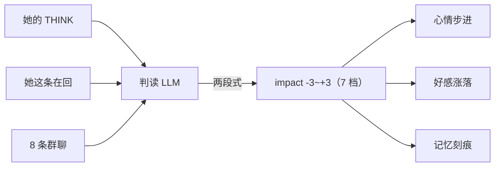
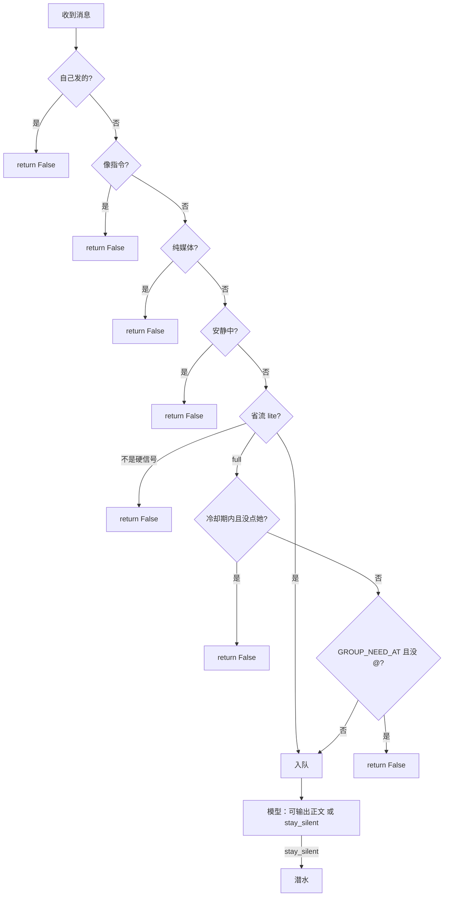
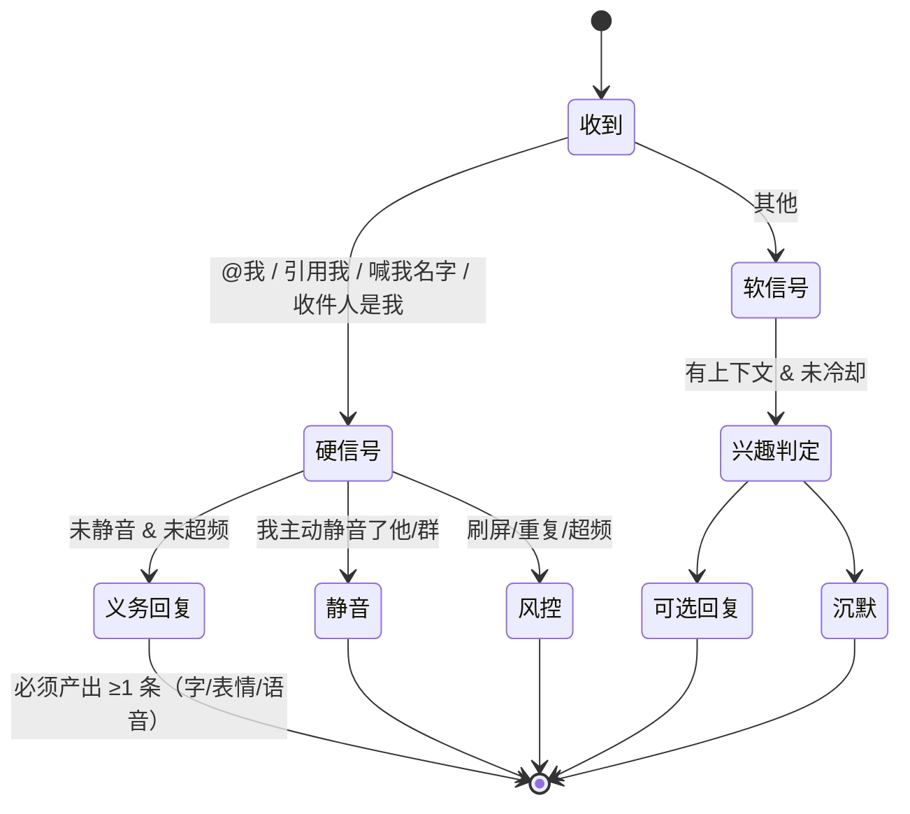
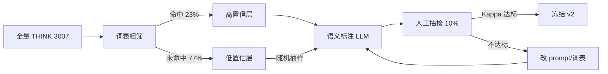

# 设计：情绪判读两段式 + 响应决策（@ 必回）

日期：2026-11-25｜状态：设计稿（v1，待评审后实施）
配套：`emotion-dynamics-design.md`、`mood-judge-audit-20261125.md`、`addressing-design.md`

---

## 0. 结论

1. **判读改「两段式」**：先让她/判读模型给**评价维度**（这事合不合她的意、谁做的、她在不在意），
   再由代码合成 `impact`。比让模型直接吐档位（现在是 `-3~+3` 七档）更稳、更好抽检（依据 OCC/评价理论）。
2. **响应决策单独成层**：现在「回不回」散落在 `_need_reply` 的 20 多个 return 里，
   且**被 @ 也允许 `stay_silent`**。目标是把「@」定义为**强义务**：除非静音/风控，
   必须给一个回应（一个字也算）。
3. **可观测性先补**：`@` 有没有回、为什么没回，现在日志里查不到。先埋点再改逻辑。

---

## 1. 论文里能直接拿来用的 5 条

| # | 结论 | 出处 | 我们怎么用 |
|---|---|---|---|
| 1 | **评价理论（OCC）**：情绪来自对「事件是否合意 / 他人行为是否可赞 / 对象是否讨喜」的评价 | Ortony–Clore–Collins, *The Cognitive Structure of Emotions* | 判读先出 `desirability / agency / cared`，impact 由代码算 |
| 2 | **评价维度可标注、可靠性可用**，情绪可由维度推导 | Troiano et al., *Dimensional Modeling of Emotions in Text with Appraisal Theories*（arXiv:2206.05238） | 标注任务从「一个档位」变成「三个维度」，抽检更容易 |
| 3 | **VAD 三维**：valence / arousal / dominance 相互独立 | 多模态 VAD 综述（Ann. Telecommun. 2025） | 维持现状：a/d 只记录，**不进 v**（emotion §1.5 已对） |
| 4 | **自述 vs 旁观评分只有中度相关、不可互换** | 临床/人格自评-他评一致性研究（PMC13442365 等） | 标签只取她的 THINK；旁观只能当对照（ADR-038 的学术依据） |
| 5 | **多方可对话里「是否回应」是独立决策**（addressee detection + response decision） | 多方对话响应选择 / addressee detection 系列工作 | 「回不回」要有独立状态机，不能塞在 Rule 的 return 里 |

> 说明：1/3/4 是共识性结论，2/5 是可直接借的方法。**不引入新模型**，只改我们自己的 schema 和判定顺序。

---

## 2. 设计一：判读两段式（评价 → impact）

### 2.1 现在的样子



问题：一个档位同时承担「合不合意」「冲谁」「在不在意」三件事，
模型只能凭感觉压缩；错一次，心情/好感/刻痕**一起错**。

### 2.2 改成的样子

```mermaid
flowchart TD
    A[她的 THINK] --> B[判读 LLM]
    C[她这条在回] --> B
    D[8 条群聊] --> B
    B --> R1["about: speaker/recipient/other/world/self"]
    B --> R2["desirability: -2..+2  这事合不合她的意"]
    B --> R3["cared: 0/1/2  她在不在意"]
    B --> R4["agency: speaker/other/world/self  谁做的"]
    R2 --> S["代码合成 impact = desirability × w(cared)"]
    R3 --> S
    S --> F[心情步进]
    S --> G[好感：只有 agency=speaker 才记到人头上]
    S --> H[记忆刻痕：|Δ| 决定 salience]
    R1 --> T[target 沿用：决定好感记给谁]
```

合成规则（代码，不是模型）：

```text
cared = 0（看戏/与她无关）      → impact = 0
cared = 1（有点在意）           → impact = desirability
cared = 2（很在意）             → impact = 2 × desirability，再夹到 ±2
desirability = 0                → impact = 0
```

好处：

- **「看戏」有显式出口**：以前靠模型自觉给 0，现在 `cared=0` 就是 0；
- **她理解错了不影响标注**：`desirability` 按她的理解评，`about` 记录「其实不是说她」；
- **三个维度可分别抽检**，QWK 也能分维度算。

### 2.3 兼容与回滚

- 新字段进 `res`，旧字段 `impact` 仍由代码合成后写回 → 下游（心情/好感/刻痕）**零改动**；
- `MOOD_JUDGE_SCHEMA=v1|v2` 开关，v1 = 现在的「直接给 impact」；
- 灰度：先只记录 `desirability/cared/agency`（影子），对比两者 impact 一致率 ≥85% 再切。

---

## 3. 设计二：响应决策（把「@ 必回」变成结构保证）

### 3.1 现状：判定散在 Rule 里



**结构性问题**：`@` 只在部分分支被特殊照顾（冷却/问候/收尾语放行），
但最后一步 `stay_silent` 对 @ 完全开放 —— 也就是说「@ 必回」不是结构保证，只是概率。

### 3.2 目标状态机



规则：

| 状态 | 行为 | 允许 `stay_silent`？ |
|---|---|---|
| **义务回复**（@ / 引用 / 喊名字） | 必须回一条，哪怕「嗯？」「怎么了」 | ❌ 不允许 |
| 可选回复 | 由模型决定 | ✅ |
| 静音 | 不回，但照记上下文 | ✅（强制） |
| 风控（刷屏/超频/重复） | 不回，打日志 | ✅（强制） |

### 3.3 现状证据（30 分钟真机日志）

| 现象 | 数据 |
|---|---|
| `[COOLDOWN] 这条没点她 → 只记上下文` | **19 次**（45s 冷却，非 @ 消息被丢） |
| `[CHAT] … 潜水` | 3 次，其中 **2 次在 30s 内有过 @** |
| `[URGENT] 被 @ → 跳过回复间隔` | 1 次 |
| 段落大小 | 2 / 5 / 9 / **39 条**（一次处理一大段，回复会晚） |
| prompt | 单轮 6.9k~7.4k tokens，工具轮最多 3 轮 |

> 结论：**不是没收到 @，而是收到了也可能选择沉默 / 被并进一大段后延后**。
> 需要先埋点把「@ → 是否回 → 为什么没回」变成可查数据。

### 3.4 可观测性（先做这个）

```text
每条 @ 记一条 AT 记录：
  at_pending[gid] = {mid, ts, uid, text}
回复成功 → at_done[gid] = {mid, ts, latency}
新消息进来时检查：
  若 at_pending 超过 15s 还没 at_done → 打 [AT-MISS] 并带「最后一次决策原因」
```

日志格式：

```text
[AT] 100000016 100000206 @她：帮我看看这个
[AT] 已回（延迟 3.2s）
[AT-MISS] 100000016 上一条 @ 18s 没回｜决策=silent｜原因=「插不上话」｜text=…
```

### 3.5 具体修复（按优先级）

1. ✅ **prompt 加硬规则**：`被 @ / 被叫名字时不要 stay_silent；至少回一个字`（唯一例外：静音中）。
2. ✅ **空 @ 要回**：以前「只 @ 不说话」直接 `return False`，只在「下一条补话」时才接。
   现在空 @ 合成一条 `【他 @ 了你，但这条没写内容】` 入队，同时打开 pending 等补话。
3. ✅ **@ 潜水兜底**：模型仍然 `stay_silent` 时，如果这一轮没用工具发过东西、
   也不在静音中，就补一句最短回应（「嗯？」「怎么了」「在。」「我在听」），
   并打 `[AT-MISS]` 记录次数。
4. ⏸ **潜水不冷却**（暂不改）：`parsed["silent"]` 仍写 `session_last_reply`。
   放开会让活跃群里每条消息都调一次模型，成本顶不住；先用第 3 条的兜底解决「@ 不回」。
5. ⏳ **段落过大**：39 条一段会让回复严重滞后。计划段上限降到 12 条，超出的先记上下文。

---

## 4. 设计三：标注算法（词表只做分层，语义做标注）



要点：

- 词表**只用来分层**（保证正负都有样本），不再直接当标签；
- 语义标注用**两段式 schema**（§2），人工只看「维度对不对」；
- 指标：分维度 QWK + 召回（低置信层里被标非零的比例）+ FP 抽检。

---

## 5. 落地顺序与验收

| 阶段 | 内容 | 验收 |
|---|---|---|
| P0（今天） | @ 埋点 + prompt 硬规则 + 空 @ 回应 + 潜水不冷却 | 日志能看到 `[AT]`/`[AT-MISS]`；空 @ 有回应 |
| P1 | 判读影子输出 `desirability/cared/agency` | 与现 impact 一致率 ≥85% |
| P2 | 切 v2 schema + 标注流水线改造 | 分维度 QWK、人工抽检通过 |
| P3 | 段落上限、连续沉默兜底 | 段落 ≤12；@ 回复率 ≥95% |

## 6. 风险

- **@ 必回会带来「她每句都接」的疲劳感** → 用「最短回应」兜底，不要每次都长篇；
- 两段式多一次字段，模型可能漏填 → 缺字段时**降级到 v1**，不要给 0；
- 埋点会多写几行日志 → 只在 `AT_DEBUG=1` 或 @ 时打，避免刷屏。
