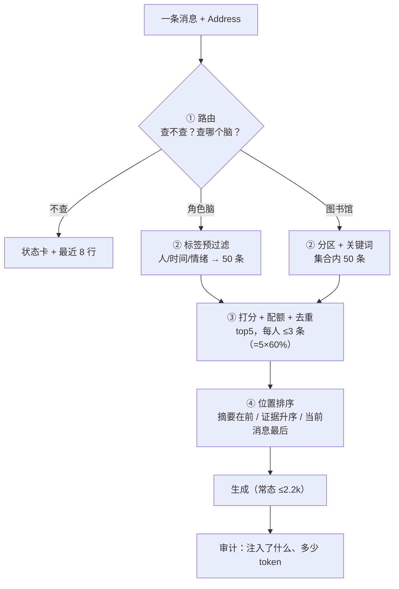

# 注意力与上下文设计 v2

> **导航**：[设计主文档](DESIGN.md) ｜ 相关：[检索](retrieval-design.md) · [收发件人](addressing-design.md) · [流水线](pipeline-map.md)
> **本文回答**：给多少、按什么顺序、引用怎么当锚点、标签怎么减量、成本怎么控。
> **本文不回答**：检索算法、情绪公式。
> **预算数字以 [DESIGN §3.3](DESIGN.md) 为准。**

---

## 0. 结论

> **注意力是预算，不是仓库。**
> 目标不是「把知道的都塞进去」，而是「让最该被看到的 5 条，出现在最容易看到的位置」。

三条硬约束：

| 约束 | 现实 |
|---|---|
| 质量 | 越长越差、中间最差（Lost in the Middle / Context Rot） |
| 成本 | 每轮多 1k token，一天几千条就是真金白银 |
| 延迟 | 群聊 2~5s 要有反应；RAG 10s 已经超了 |

顺序：**先减量（路由/标签/配额）→ 再排序（位置）→ 最后压缩**。

---

## 1. 论文结论（只留能改代码的）

| 工作 | 结论 | 我们怎么用 |
|---|---|---|
| **Lost in the Middle**（Liu, TACL 2024） | 开头/结尾好，中间差（U 形） | 证据**升序**，最相关放最后；摘要放最前 |
| **Found in the Middle**（2024） | 位置偏差可用重排缓解 | 先保证分数准，再谈位置 |
| **RULER / NoLiMa**（2024-2025） | 有效长度远小于标称；干扰越多越差 | 按 token 硬截断，不按条数 |
| **Context Rot**（Chroma 2025） | 输入越长，性能单调下降 | 能 2.2k 不 10k |
| **Attention Sinks**（Xiao 2023） | 开头 token 吃注意力 | system 越短越好 |
| **Attention is not Explanation**（Jain 2019） | 注意力≠解释 | 审计记「给了什么」，不声称「模型看了哪」 |
| **LLMLingua / RECOMP / FILCO** | 过滤 > 压缩；实体/数字/否定词易压坏 | 先 min_score+配额+去重；压缩保护名单 |
| **Adaptive-RAG / Self-RAG** | 按需检索 | 纯情绪不查；本地能答不查图书馆 |
| **Oblivion** | 读路径门控 | `relevance<0.25` 的窗口只衰减、不判读 |

---

## 2. 四个杠杆



### 2.1 路由：不查最省

```text
查角色脑：记得 / 上次 / 以前 / 你说过 / 约定 / 具体人名
查图书馆：什么是 / 为什么 / 出自 / 哪首诗 / 《》 / 讲的是什么
都查：既有「他/上次」又有「什么是/《》」
都不查：纯情绪、纯表情、纯附和、<6 字且无实词
```

⚠️ 两条实测教训：

1. `小明是怎么解决温室效应的？` 没有书名号 → 被判成角色脑 → 0 命中。
   **路由不能靠标点，要靠 intent（规则 + 极短分类兜底）。**
2. 「他/她」几乎每条都有，**不能单独作为「必查」信号**；
   只有「指代在最近 8 行里解析不到」才查。

### 2.2 标签 = 预注意力过滤

库里有 8414 条记忆、9273 篇文档；模型只看 5 条。
**先用 SQL 把候选降到 50，再排序**（详见 retrieval §4）：

```sql
-- 「老大上次为什么对我心情变好」
SELECT * FROM mood_events
WHERE about_qq=? AND direction='+' ORDER BY ts DESC LIMIT 5;
```

现状：`tags` 非空 54/8414（0.6%）——这是最大短板，不是模型问题。

### 2.3 引用 = 显式注意力锚点

群聊里「他/这个/那张」指代不清，是引用错人和答非所问的主因。
引用回复本身就是**人工标注的共指**，要用足（详见 addressing）：

| 做法 | 效果 |
|---|---|
| `<reply:mid>` → 结构化 `anchor={mid,sender,text,ts}` | 模型不用猜「他」是谁 |
| 被引原文**只给一次全文**，紧贴当前消息上方 | 近因效应 |
| 多引用 → 分气泡（`|||`），每气泡各自 anchor | 不把两件事塞进一个引用 |
| 引用的是图/表情 → 视觉摘要 + 「这条是图」 | 防止「开会累」挂到蓝猫图上 |
| 没引用但被 @ → anchor = 被 @ 那条 | 系统兜底也要有锚点 |

反模式：把引用原文再复述一遍。

### 2.4 位置与预算

> **顺序只在 [prompt-skeleton §1](prompt-skeleton-design.md)，数值只在 [DESIGN §3.3](DESIGN.md)。**
> 本节不再复制骨架和预算表——上一版在这里复制了一整张表，结果工具位置和 prompt-skeleton 打架。

四条不变的原则（不含数字）：

1. **persona / 协议在最前且不变** → 前缀缓存能命中；
2. **工具放后段（⑦c），不紧跟协议** → 工具每轮按描述检索变化，放前面会让前缀从那一行起失效；
3. **证据按分数升序**，最相关紧邻当前消息；
4. **anchor 是最后一条 system**，紧贴 user。

### 2.5 压缩：最后才用

- 只压叙述性长句；不压人名/时间/数字/否定词/引用原话；
- 优先抽句（含答案的句子），不生成摘要；
- 摘要只用于「全局背景」，证据必须可核对出处。

---

## 3. 流水线改动点

| 阶段 | 现在 | 改成 | 省什么 |
|---|---|---|---|
| ② 该不该回 | 每条都进动态取数 | 先判 intent | 一次 RAG 10s + 1k token |
| ④ 取数 | 各服务各查各拼 | 资源注册表 + 统一预算 + 去重 | 重复摘要/重复记忆 |
| ④ 记忆 | 全文混搜 | 标签预过滤 → 打分 → top5 | 8000 → 50 |
| ④ 图书馆 | 整句丢 RAG | 分区 + 关键词 + 回填小节 | 命中↑、延迟↓ |
| ⑤ 生成 | 26 个工具全挂 | 描述检索 top6 | ~1000 token/轮 |
| ⑤ 生成 | 证据降序 | 升序（最相关最后） | 中间丢失 |
| ⑥ 输出 | 引用靠自觉 | anchor 结构化 + 分气泡 | 引用错人 |
| ⑧ 观测 | 只记 token | 记注入清单（ref/score/token） | 可归因 |

---

## 4. 怎么验证

| 指标 | 定义 | 目标 |
|---|---|---|
| `evidence_precision@5` | top5 真正相关比例 | ≥0.6 |
| `gold_position` | 标准证据相对位置（0 前 / 1 后） | >0.7 |
| `lost_in_middle` | gold 放头/中/尾各跑一次 | 中 vs 尾差 <10% |
| `distractor@5` | 同人无关/近重复占比 | ≤0.1 |
| `context_tokens` | 每题注入 token | 常态 ≤2.2k |
| `cost_per_turn` | token×单价 + RAG 时间 | 群聊 ≤0.003 元/条 |
| `groundedness` | 答案实体/数字能在证据找到 | ≥0.9 |

已实现：`avg_ctx_tokens`、`distractor@5`、`gold_position`（`scripts/eval_gold.py`）。
`lost_in_middle` 三位置回放：

```bash
python scripts/eval_gold.py --stage position          # gold 放头/中/尾
python scripts/eval_replay.py run --set data/eval/position_replay.jsonl \
    --deterministic --out data/eval/position_replay_out.jsonl
python scripts/eval_replay.py judge --set data/eval/position_replay_out.jsonl \
    --out data/eval/position_judged.jsonl
python scripts/position_report.py                     # 中 vs 尾差 <10% 才 PASS
```

> `gold_position` 口径：生产把最相关证据放**最后**，所以检索 rank=1 → 1.0；
> 没命中 → 0。`lost_in_middle` 只比较「同样 5 条证据、只改 gold 位置」的准确率差，
> 不混入检索质量。

---

## 5. 反模式

1. 3 份群总结都塞（同一件事写 3 遍）；
2. 26 个工具 spec 每轮全挂；
3. 证据按分数降序（最相关被埋中间）；
4. 把「心理活动」原话当证据；
5. 引用原文再复述；
6. 图书馆整篇回填；
7. 压缩掉人名/数字/否定词；
8. 声称「模型注意力集中在 X」。

---

## 6. 参考

- Liu et al., *Lost in the Middle*, TACL 2024.
- Hsieh et al., *Found in the Middle*, 2024；*RULER*, 2024.
- Kuratov et al., *NoLiMa*, 2025.
- Chroma, *Context Rot*, 2025.
- Xiao et al., *Attention Sinks / StreamingLLM*, 2023.
- Jain & Wallace, *Attention is not Explanation*, NAACL 2019.
- Jiang et al., *LLMLingua / LongLLMLingua*, 2023-2024.
- Xu et al., *RECOMP*, 2023；Wang et al., *FILCO*, 2023.
- Jeong et al., *Adaptive-RAG*, NAACL 2024；Asai et al., *Self-RAG*, 2023.
- Naim et al., *Oblivion: 记忆读写解耦*, 2025.
