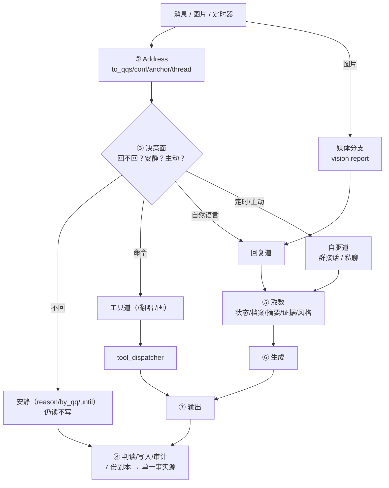

# 设计审计：历史文档 vs v2（2026-11-25）

> 范围：`docs/` 下 43 份文档 + 代码里的实际模块。
> 目的：找出 **v2 漏掉的设计**、**v2 与旧设计的矛盾**、**该归档的旧设计**。
> 结论只影响文档，不改代码。

---

## 0. 结论

1. **v2 不是「全量」**：它覆盖了情绪/检索/注意力/收发件人/风格/prompt，但**漏了 12 个仍在跑的设计**（表达节奏、翻页协议、conv_state、focus、lore、主动接话/私聊、安静/破冰、识图、档案卡片、语气兜底、per-person 安静、三套工具）。
2. **有 10 条旧红线没进 v2**（20 字、工具只收不发、前缀缓存、群前缀、ContextVar…），其中 3 条与 v2 表述冲突（正则、预算、群前缀）。
3. **有 6 份旧文档已被 v2 取代**，但仍在 README「设计」区，容易被当成现行方案。
4. **两处命名冲突**：`attention`（v2=上下文预算 vs 旧=表达节奏）、`cause` vs `target`（旧 4 值 vs 新 3 值）。
5. 建议：**先补漏、再归档、最后才动代码**。

---

## 1. 文档分级

### 1.1 现行（v2，9 份）

| 文档 | 角色 |
|---|---|
| `DESIGN.md` | 唯一口径 + ADR |
| `addressing-design.md` | 收发件人 |
| `emotion-dynamics-design.md` | 心情/关系 |
| `retrieval-design.md` | sqlite/RAG/评测 |
| `attention-design.md` | 上下文预算 |
| `prompt-skeleton-design.md` | 块结构 |
| `pipeline-map.md` | 8 段链路 |
| `style-white-moon-design.md` | 风格/白月光 |
| `emotion-annotation-spec.md` | 200 条标注 |

### 1.2 as-built（仍有效，但只描述现状）

`architecture-map`、`memory-profile-design`、`features`、`vision-pipeline`、
`persona-card`、`persona-tone`、`style-modules`、`whitemoon`、`tuning`、
`deployment`、`node-compute`、`node-params`、`model-providers`、`harness-bridge`、
`plugin-dev`、`third-party-integration`、`usage-report`、`CHANGELOG`、`CREDITS`。

> 这些要保留，但顶部应标「as-built 快照；设计以 DESIGN.md 为准」。

### 1.3 已被取代（建议归档）

`master-design`、`mood-affinity-design`、`reply-pipeline`、`agent-pipeline`（部分）、
`feature-audit`、`implementation-status`、`review-2026-11-20`、`review-2026-11-24`、
`full-audit-2026-11-20`、`harness_design`、`harness_stack_selection`、`third-party-audit`。

> `maibot-analysis` 是外部参考，保留在「参考」区，不算设计。

---

## 2. 矛盾清单（v2 ↔ 旧）

| # | 旧设计 | v2 现状 | 严重度 | 处理 |
|---|---|---|---|---|
| M1 | **Δ 不是「记不记」的开关**；记忆每 turn 都记，Δ 只决定加粗/检索（mood-affinity §8.3） | v2 §6 用 `|ΔVAD|` 算 salience，但没写「记录触发独立」 | 🔴 | 补一句：记录由 MEMO/事件/fact 触发；Δ 只决定 `storage/加粗` |
| M2 | **一个 Δ 三处用**（salience/valence/Δaff，master §4） | v2 改为 impact→z→步进+锚点 | 🟠 | 旧公式作废；只继承「只认个人导致」 |
| M3 | `cause` 4 值：speaker/environment/self/other | v2 `target` 3 值：speaker/recipient/world | 🔴 | 扩成 5 值：speaker/recipient/other/world/self |
| M4 | 同一段对话 **7 份副本**（architecture §4.1） | v2 pipeline §2 说「5 份」 | 🟠 | 改成 7 份并列出；单一事实源目标不变 |
| M5 | 安静支持**群 / 人（gid:qq）** + `until` + `reason/by_qq` | v2 只有全局 quiet 倾向分 | 🟠 | 补 per-person 与 `stay_silent/until` |
| M6 | `attention` = **表达节奏**（DRIFT/ANCHOR/REACTION） | v2 `attention` = 上下文预算 | 🔴 | 改名：v2 叫「上下文预算」，旧模块叫「表达节奏」 |
| M7 | 20 字规矩 + 长文合并转发（红线 1） | v2 输出段没写 | 🟠 | 补进 DESIGN 红线 |
| M8 | 工具只收不发（红线 2） | v2 工具道没写 | 🟠 | 补 |
| M9 | **不用正则猜语义**（红线 3） | v2 路由规则大量关键词（记得/上次/什么是） | 🟠 | 限定：规则只做**召回提示**；该不该回/对谁说仍由 LLM+结构信号 |
| M10 | 记忆必须带**群前缀**（红线 5） | v2 用 `gid` 列/索引 | 🟡 | 迁移时兼容旧前缀，或明确只认 `gid` 列 |
| M11 | **前缀缓存**：persona+规矩放最前、不改（红线 7） | v2 prompt 顺序符合，但没写理由 | 🟡 | 补进 prompt-skeleton |
| M12 | 群心情 `group_mood` 独立于整体心情 | v2 全局心情独立慢变量，群氛围是输入 | 🟡 | 明确：`group_mood`=群因子，`v_global`=跨群慢变量 |

---

## 3. 漏看的设计 + 定位

> 「定位」= 在 v2 的哪一段、哪一层、给多少预算、是否参与数值。

### 3.1 表达层

| # | 设计 | 功能 | v2 定位 | 预算 |
|---|---|---|---|---|
| L1 | **表达节奏**（旧 `services/attention.py`） | 走神/回钩/短反应三旋钮，让回复有活气 | 风格层（style 块之后 / post_rules），**不参与数值** | ≤80 token |
| L2 | **语气漂移与兜底**（persona-tone / aura_logic） | 防止越回越冲；检测死字/攻击性 | 输出后处理（⑦），规则，0 token | 0 |
| L3 | **expression 表达学习** | 她自己的口癖（≤24 字短句） | 已在 v2 style 四层里（expression 120） | 120 |

### 3.2 记忆 / 档案层

| # | 设计 | 功能 | v2 定位 | 预算 |
|---|---|---|---|---|
| L4 | **翻页/自省协议** `[[MEMORY|…]]` `[[PROFILE|…]]` `[[HISTORY|20]]` | 防止她以为「只有 4 条」 | 协议块 + 检索目录模式；每块结尾写「共 N 条、怎么看剩下」 | 40 |
| L5 | **conv_state**（topics/background/progress/pending/agreements） | 比一句 summary 更长的背景 | 群摘要升级（⑤），放 evidence 前 | 120→150 |
| L6 | **focus_card**（人物 brief） | 深度人物卡（人/事/关系/她在他面前） | 档案块的「深度版」，只在 focus 场景用 | 100（替代简版） |
| L7 | **lore / lore_post**（群设定词条） | 群世界观/梗，命中才给 | 证据的一种来源（带出处） | ≤80 |
| L8 | **档案卡片**（头像+十件事） | 完整档案视图 | 命令/工具（`/档案`），**不进每轮 prompt** | 0 |
| L9 | **白名单 ≠ 只有他们有档案** | 白名单只决定回不回，不决定记不记 | 档案采集策略（②/⑧） | 0 |

### 3.3 决策 / 自驱层

| # | 设计 | 功能 | v2 定位 | 预算 |
|---|---|---|---|---|
| L10 | **主动接话** `_random_chat_loop` | 群里看热闹插一句 | 自驱车道（群）：mood×intimacy×drift + 冷却；先看 20 条再开口 | 0（触发时才走回复道） |
| L11 | **主动私聊** `proactive.py` | 按关系/心情挑人私聊 | 自驱车道（私聊）：5 类依据（关系/记忆/conv_state/心情/原文） | 0（触发时才走回复道） |
| L12 | **安静 / 破冰** `chat_switch` + `stay_silent` + `maybe_thaw` | 群/人粒度安静；道歉给台阶 | 决策层（③）：输出 decision + reason/by_qq/until；API 层 `stay_silent` | 0 |
| L13 | **per-person 安静**（gid:qq） | 只不理某个人 | 决策层（③）的粒度 | 0 |

### 3.4 媒体 / 工具层

| # | 设计 | 功能 | v2 定位 | 预算 |
|---|---|---|---|---|
| L14 | **识图链路** `vision_agent` | 画面 + 番名 + 搜图源 → 报告 | 媒体分支（①→⑤）：report 作为证据；**不复述画面** | 200（证据内） |
| L15 | **三套工具概念** | tool_registry / napcat_tools / self_tools+harness | ⑦ 手：工具检索只针对 registry；napcat 底层；self/harness 可选后端 | 工具 300 |
| L16 | **重启补现场**（dialogue 补 24 条） | 重启后线程/收件人不空 | ② Address 冷启动兜底（与 threads 落盘互补） | 0 |

### 3.5 观测层

| # | 设计 | 功能 | v2 定位 |
|---|---|---|---|
| L17 | 周报/日记/journals/daily_summary | 长期总结、回访素材 | ⑧ 观测层，不进每轮 prompt |
| L18 | 审核 LLM（scene_auditor） | 修正低置信收件人 | ② Address 的修正器，不是独立阶段 |
| L19 | 群聊标签第三用途：记忆归属 | 群隔离 | ⑧ 写入时带 `gid`/群前缀 |

---

## 4. 该归档 / 删除的旧设计

| # | 文档 | 原因 | 处理 |
|---|---|---|---|
| O1 | `master-design.md` | 「一个 Δ 三处用」被步进+锚点取代 | 红线迁进 DESIGN 后归档 |
| O2 | `mood-affinity-design.md` | 12h/SMOOTH/单标量/Δ 映射已被取代 | 保留 as-built 事实，设计部分归档 |
| O3 | `reply-pipeline.md` | 8 块/16s 被 pipeline v2 取代 | 归档 |
| O4 | `agent-pipeline.md` | master 自己标「多处过期」 | 迁移 L4/L10~L13/L16 后归档 |
| O5 | `feature-audit.md` / `implementation-status.md` | 2026-11-20 快照 | 归档 |
| O6 | `review-2026-11-20.md` / `review-2026-11-24.md` / `full-audit-2026-11-20.md` | 历史体检 | 归档 |
| O7 | `harness_design.md` / `harness_stack_selection.md` | 早期方案；现行只有 `harness-bridge.md` | 归档 |
| O8 | `third-party-audit.md` | 一次性审计 | 归档 |

> 建议建 `docs/archive/`，README 分「现行 / as-built / 归档 / 参考」四区。

---

## 5. 整体图（补齐后的五条车道）

**五条车道**：

| 车道 | 触发 | 是否走取数 | 是否走生成 |
|---|---|---|---|
| 回复道 | 有人在跟她说话 | 是（可缺块） | 是 |
| 工具道 | 命令 / 模型决定调工具 | 否（只最小状态） | 命令否 / 自然语言是 |
| 自驱道（群） | 定时 + 热闹 | 是 | 是 |
| 自驱道（私聊） | 定时 + 关系/心情 | 是 | 是 |
| 媒体分支 | 图片/视频 | 视觉报告作为证据 | 是 |

---

## 6. 建议动作（按顺序，仍不改代码）

### 第一批：补漏（只改文档）
1. DESIGN 新增 **§9 工程红线**（20 字、工具只收不发、前缀缓存、群前缀、ContextVar、失败留痕、两套格式、不用正则猜语义）。
2. emotion 补 **M1**（记录触发独立）、**M3**（cause/target 5 值）、**M5**（per-person 安静）。
3. pipeline 补 **M4**（7 份副本）、**L10~L13**（自驱/安静车道）、**L16**（补现场）。
4. style 文档补 **L1 表达节奏**、**L2 语气兜底**。
5. prompt-skeleton 补 **L4 翻页协议**、**M11 前缀缓存**。
6. retrieval 补 **L5 conv_state**、**L6 focus**、**L7 lore**、**L19 群隔离**。
7. vision 文档补 **L14** 在 pipeline 的定位（媒体分支）。

### 第二批：归档（会动文件）
8. 建 `docs/archive/`，移动 O1~O8；README 四区。
9. 给保留的 as-built 文档加 banner。

### 第三批：口径回写
10. 把本报告 M1~M12 的结论回写进 DESIGN §4 ADR（新增 ADR-021~023）。

---

## 7. 需要你拍板

1. **`cause` 扩成 5 值**（speaker/recipient/other/world/self）接受吗？
   （不扩的话，「群里第三个人骂她」只能记成 world，好感不会动。）
2. **表达节奏（旧 attention）** 是并进 `style-white-moon-design.md`，还是单开 `rhythm-design.md`？
3. **主动接话 / 主动私聊** 是否单开 `proactive-design.md`（算第六条车道）？
4. **是否建 `docs/archive/` 并移动 8 份旧文档**（会影响 GitHub 里的旧链接）？
5. **记忆「每 turn 都记、Δ 只决定加粗」** 是否保留为 v2 的硬规则？

---

## 8. 决策落地（2026-11-25 11:48）

| # | 决策 | 落地 |
|---|---|---|
| 1 | `cause/target` 扩成 **5 值**：speaker/recipient/other/world/self | ADR-021；emotion §5.2 表格 |
| 2 | 表达节奏（旧 attention）**并入**风格文档 | `style-white-moon-design.md §2.6`（≤40 token，不参与数值） |
| 3 | 主动接话/私聊**单开**文档，按心情+好感驱动 | [proactive-design.md](proactive-design.md) |
| 4 | 建 `docs/archive/`，移动 8 组 12 个文件 | [archive/README.md](archive/README.md) |
| 5 | 记忆「每 turn 都记，Δ 只决定加粗」保留 | ADR-024；emotion §6、retrieval §3.4 |

> 第 5 条的边界：**记录语义不变；sqlite 改的是检索**（时间 × 情绪双维融合），
> 不改变「记不记」，只改变「好不好查、排多前」。

### 已同步补进 v2 的漏看项

- 翻页协议（`[[MEMORY]]`/`[[PROFILE]]`/`[[HISTORY|20]]`）→ prompt-skeleton §2.2
- 安静 per-person / `stay_silent` / `until` / 破冰 → emotion §4
- 重启补现场 / 看 20 条 / 识图定位 → pipeline §4.1
- conv_state / focus_card / lore / 群隔离 → retrieval §3.4
- 工程红线 12 条 + 自检 10 问 → DESIGN §9/§10

---

## 9. 识图决策（2026-11-25）

| 项 | 决策 |
|---|---|
| 本地角色库 | **不建**（`trace.moe / SauceNAO / Ascii2D / IQDB` 已是云端源） |
| 角色名 | 云端元数据（作品/作者/角色 tag）+ 视觉模型 + 轻量 `character_alias` 表 |
| 域 | 只做动漫/插画，**不做真人脸**（合规） |
| 算力 | 算力机异步任务（GPU）；bot 只编排（2C/3.4G 无 GPU） |
| 优先级 | **暂缓**，排在 P0~P9 之后 |

> 结论：不是「以图搜图」，是「云端源 + 元数据 + 视觉模型」拼出角色名；
> 本地只留一张别名表，不存图片/embedding。

### as-built banner

已给 9 份文档加「as-built 快照」横幅：
`architecture-map`、`memory-profile-design`、`features`、`vision-pipeline`、
`persona-card`、`persona-tone`、`style-modules`、`whitemoon`、`usage-report`。
