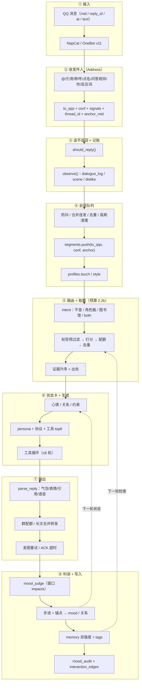
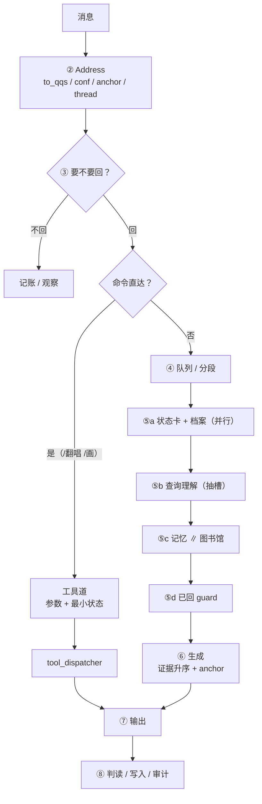
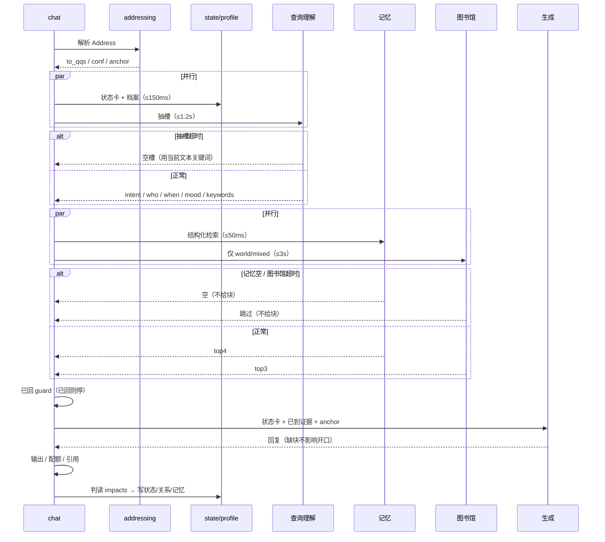
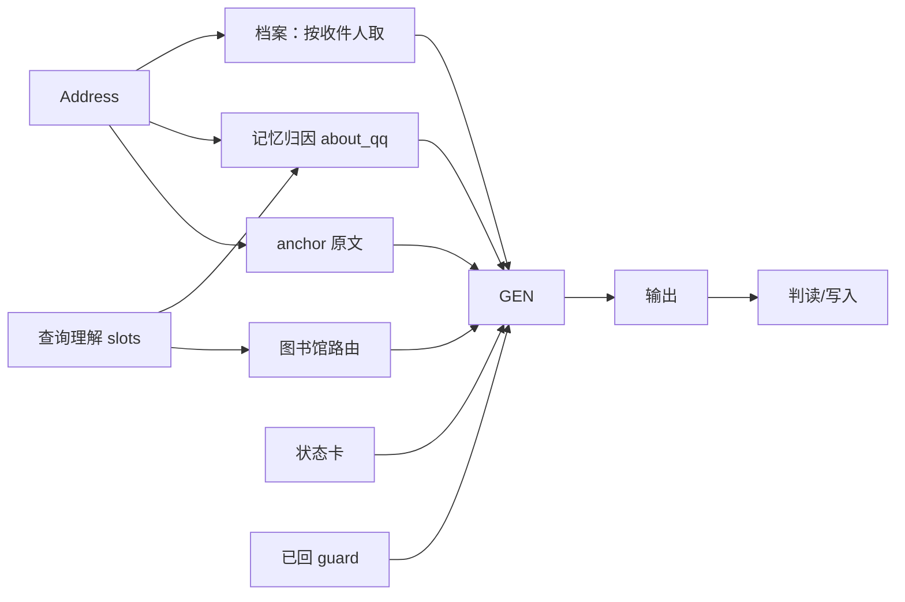

# 消息流水线 v2

> **导航**：[设计主文档](DESIGN.md) ｜ 相关：[收发件人](addressing-design.md) · [情绪](emotion-dynamics-design.md) · [检索](retrieval-design.md) · [注意力](attention-design.md)
> **本文回答**：一条消息经过哪些阶段、每个阶段谁负责、还剩哪些缺陷。
> **本文不回答**：公式与参数（见 DESIGN §3）。

---

## 1. 总图（8 段）



---

## 2. 每段的输入 / 输出（实现时按这个对）

| 段 | 输入 | 输出 | 关键文件 |
|---|---|---|---|
| ① 接入 | QQ 事件 | `mid / reply_id / at / text / gid / qq` | `plugins/chat` |
| ② 收发件人 | 上 + 名册 + 上一条 | `Address{to_qqs,conf,signals,thread,anchor}` | `group_scene` |
| ③ 该不该回 | Address + 开关 | `bool` + 记账 | `chat._need_reply` |
| ④ 队列 | 消息 | 一段 `records[]`（带 to/conf/anchor） | `segments` |
| ⑤ 取数 | 段 + intent | 证据（≤5，带出处，≤500 token） | `memory_v2 / agent_client` |
| ⑥ 生成 | 状态卡 + 证据 + persona | 文本 + 标签 | `prompt_builder / llm` |
| ⑦ 输出 | 文本 | 气泡 / 引用 / 语音 / 图 | `chat.parse_reply` |
| ⑧ 判读 | 窗口 + Address | impacts → 状态/关系/记忆/审计 | `mood_judge / mood / memory_v2` |

---

## 3. 判读时机（ADR-013）

```text
默认：她回完 → 段关闭 → 判读 → 写状态（晚一轮）
      → 下一条消息用新状态（正常情况只差一轮，可接受）

快速通道（不走步进，直接钳）：这条是 @她/引用她 且命中强负面（辱骂/否定/威胁）
      → v = min(v, −0.45)（只降不升），P ×1.5，标 provisional
      → 正式判读正常步进，不额外惩罚
```

为什么不全同步判读：一次判读 1~3s，群聊延迟会被拉到 5s+，而且大部分消息不需要。
为什么要有快速通道：否则会出现「刚被骂完还在笑」这种明显穿帮。

---

## 4. 收发件人在流水线里的位置（旧文档缺的一块）

```text
② 算 Address → ④ 存进 segment → ⑤ 进 prompt 的 anchor → ⑧ 进判读的 target
                                    ↘ ⑥ 分气泡时各自 anchor
                                    ↘ ⑧ 记忆 about_qq 默认 recipient
                                    ↘ ⑧ interaction_edges（社交图）
```

没有这一步的后果（都真实发生过）：

- @ 她的那条被挤出窗口 → 她只回最后一条（2026-11-23）；
- 「A 对 B 说难受的事」记到 A 头上 → B 的关系没动；
- 引用错人（3 次不同根因）；
- 重启后现场空，收件人/线程全丢。

### 4.1 安静 / 破冰 / 重启补现场（旧设计，保留）

| 机制 | 规则 |
|---|---|
| **安静** | `chat_switch.quiet(scope, until, reason, by_qq)`；scope = 群 / 人；安静时**照常读**，只是不回 |
| **真不回** | API 层 `tool_choice={"type":"function","function":{"name":"stay_silent"}}` |
| **破冰** | 检测道歉/哄人（对不起/抱歉/我错了/别生气/原谅/和好）→ 只解除「因这个人而起」的安静；主人道歉一律给台阶 |
| **重启补现场** | `group_scene` 为空 → 从 `dialogue` 按**条数**补最近 24 条；保留原 ts/名字、按 mid 去重、图片留占位 |
| **看 20 条** | 线程视图 + 硬逻辑都按最近 20 条；最新线程给 20 句，其它线程 4 句；短句冲人 → `recent_mention`（conf 0.55） |
| **识图** | `vision_agent` 报告作为**证据**进 ⑤；块内必须写「不要在回复里复述画面」 |

---

## 5. 缺陷清单（v2，只列**还没修**的）

| # | 段 | 缺陷 | 状态 | 归属 |
|---|---|---|---|---|
| D1 | ③ | `_need_reply` 判断与记账混在一起，返回 False 也写了一遍 | 待修 | 本文 §1 |
| D2 | ③ | `_enrich_text` 在规则层做网络 IO（链接/语音/引用） | 待修 | 加 1.5s 超时或移入 worker |
| D3 | ④ | `scene_auditor` 在关键路径 await（6s） | 待修 | 后台化 |
| D4 | ⑤ | 8 个取数块仍偏串行（图书馆已并行） | 部分修 | 总结复用审核结果 |
| D5 | ⑥ | 状态卡「成因/关系/心里话」混在一起 | 待修 | emotion §5 |
| D6 | ⑤ | 检索只有一路关键词 + 加权分 | 待修 | retrieval §4 |
| D7 | ⑤ | 图书馆无分区/去重/增量 | 待修 | retrieval §6 |
| D8 | ⑥ | `llm.py` 3180 行兼任协议/工具/历史/prompt/网络/落盘 | 待修 | 拆 4 模块 |
| D9 | ⑥ | 群里挂 26 个工具 | 待修 | 工具检索 top6 |
| D10 | ⑦ | 引用/自动引用规则分散在三处 | 待修 | 收敛 `quote_selector` |
| D11 | ⑦ | 语音/文件 ACK 超时判定不一致 | 待修 | 统一 `_is_ack_timeout` |
| D12 | ⑧ | 同一件事写 **7 份**：`memory.db` 短期 / `dialogue` 原文 / `memory` 长期 / `recent_group_msgs` / `group_scene` / `conv_state` / `bond notes` | 待修 | memory 为唯一源，其余是视图 |
| D13 | ⑧ | 判读慢一轮 | **已设计** | ADR-013 快速通道 |
| D14 | 全局 | 测试代码进生产（约 2200 行） | 待修 | 移出或加开关 |
| D15 | 全局 | 插件读插件私有状态（vision_agent → chat） | 待修 | 抽公共接口 |
| D16 | ⑧ | 好感/心情可刷满 | **已设计** | emotion §3.2/§8 |
| D17 | ⑧ | 好感一个系数，不吃人设 | **已设计** | emotion §2 |
| D18 | ⑤ | 取数无统一预算 | **已设计** | attention §2.4 |
| D19 | ⑥ | 全局心情没有安静/主动决策链 | **已设计** | emotion §4 |
| D20 | ⑧ | 判读锚点只有 5 条 | **已设计** | emotion §5（案例库） |
| **D21** | ② | 收发件人只用于展示，不参与归因 | **已修（高置信）** | addressing §3.2 |
| **D22** | ② | 收件人/线程只在内存，重启即丢 | 待修 | addressing §3.3 |
| **D23** | ⑤ | 图书馆 10s、路由靠标点、近重复互抢 | 部分修（2026-11-25：触发门槛收紧，闲聊不再查；见下） | retrieval §6 |
| **D24** | ⑧ | 记忆 tags 覆盖 0.6% | 待修 | retrieval §5 |
| **D25** | ⑧ | `memdb` 代码有表，线上只有 `histories` | 待修 | retrieval §8 |
| **D26** | ③ | 主动接话/私聊和回复道混在一起，互相干扰 | **已设计** | [proactive-design.md](proactive-design.md) |
| **D27** | ③ | 安静缺 per-person / `stay_silent` / `until` / 破冰 | **已设计** | emotion §4 |
| **D28** | ⑥ | 翻页协议（`[[MEMORY]]`/`[[HISTORY|20]]`）没进 prompt | **已设计** | prompt-skeleton §2.2 |
| **D29** | ① | 识图未进主链路图（现在绕开 `_need_reply`） | 待修 | vision-pipeline + 本文 §8 |
| **D30** | ⑥ | 「表达节奏」与「上下文预算」同名，容易混 | **已设计** | style §2.6 |

---

## 6. 修的顺序（和 DESIGN §7 一致）

```text
P0 口径统一（不改行为）
P1 收发件人归因（D21/D22）—— 它同时修「记错人」「引用错」「关系不动」
P2 心情闭环（D13/D16/D17/D20）
P3 关系衰减
P4 检索 sqlite（D6/D7/D24/D25）
P5 注意力（D9/D18）
P6 结构（D8/D12/D14/D15）
```

> 为什么收发件人排第一：它是**一条数据修四处**（判读/记忆/关系/引用），
> 比单独修任何一处都划算。

---

## 7. 这张图怎么用

- 讨论「她这句答得怪」：先定位是 ② 归因错、⑤ 没取到、还是 ⑥ 没用好；
- 改代码前确认改的是哪一段、会不会影响下游；
- 每修一个缺陷，把状态改成「已修 + 日期」；**不保留已修细节**（旧版的问题）。

---

---

## 8. 昨天的 pipeline → v2 定位

> 两个已定决策：
> - **D-A**：自然语言工具请求（「唱首歌」「画个猫」）仍走**回复道**，由模型决定做不做；
>   只有 `/翻唱`、`/画` 这类**命令**直达工具道。
> - **D-B**：任一环节超时，**直接用已到的块回复**；不等待、不空转；慢块后续单独优化。

### 8.1 昨天这 8 步

| # | 昨天步骤 | 本质 |
|---|---|---|
| Y1 | 唱歌等工具 → 直接调工具 | 工具分支 |
| Y2 | 心情值 + 当前状态 + 那件事的心理状态 | 状态读取 |
| Y3 | 对方档案 + 好感词 + 印象最深的一件事（来自 bond_notes，不查记忆） | 人物读取 |
| Y4 | 心情 LLM 对这段话的总结 | 查询理解 |
| Y5 | 用总结调记忆 | 检索（角色脑） |
| Y6 | 用总结调图书馆 | 检索（世界知识） |
| Y7 | 这条是否回过 / mid 有标记 | 幂等守卫 |
| Y8 | 综合参考后回复 | 生成 + 输出 |

昨天是**串行**：Y2→Y3→Y4→Y5→Y6→Y7→Y8，最坏 16s。
v2 是**双车道 + 扇出 + 超时即走**：能并行的并行，能跳过的跳过，守卫前置。

### 8.2 双车道



**自然语言工具请求走哪条**（D-A）：

```text
「唱首歌」「画个猫」「查一下这个」→ 回复道（intent=tool）
  · 仍取状态卡/档案（决定语气、愿不愿意）
  · 跳过记忆/图书馆（不需要）
  · 工具用「描述检索 top6」挂上去，由模型决定调不调
  · 可以拒绝/讨价还价（保留人格）

「/翻唱 晴天」「/画 猫」→ 工具道
  · 直接入队，不经过生成
  · 仍记 Address（知道是谁点的）
  · 结果由 tool_dispatcher 补发到原会话
```

### 8.3 逐步映射（输入 / 输出 / 超时）

| 昨天 | v2 段 | 定位 | 输入 | 输出 | 超时/降级 |
|---|---|---|---|---|---|
| Y1 工具直达 | ③→工具道 或 ⑤ intent=tool | **分支** | 命令 / 自然语言 | 任务入队 / 工具调用 | 工具离线 → 直说 |
| Y2 心情/状态/那件事心理 | ⑤a 状态卡 | **状态读取** | session + last_impact | 心情 VAD + 成因 + 关系简版 + 约束 | 读不到 → 中性一行 |
| Y3 对方档案/好感/印象 | ⑤a 档案块 | **人物读取** | **收件人 qq** | 身份/性格/称呼 + **好感词** + 印象 1 条（`bond_notes` 里 |Δ| 最大，**不查记忆**）+ 白月光 1 行（关系**数值**在状态卡） | 没档案 → 名字 + 「不熟」 |
| Y4 心情 LLM 总结 | ⑤b 查询理解 | **抽槽** | 上一段 scene summary + 当前文本 | intent/who/when/mood/topic/keywords | 超时 → 只用当前文本关键词 |
| Y5 记忆 | ⑤c 角色脑 | **结构化检索** | slots | top4（带出处/时间/人物） | 空 → 不给块 |
| Y6 图书馆 | ⑤c 图书馆 | **条件检索** | slots（仅 world/mixed） | top3（带出处 + 人称免责） | 超时/低分 → 跳过 |
| Y7 已回检查 | ⑤d guard | **幂等守卫** | session + mids | true/false | 不确定 → 先继续，发送前再查 |
| Y8 综合回复 | ⑥→⑦ | **生成 + 输出** | 已到块 | 文本/气泡/引用 | 生成失败 → 兜底短句 |

> 各块的最终文本（状态卡/档案/证据/anchor/分气泡）见
> [prompt-skeleton-design.md](prompt-skeleton-design.md)。

### 8.4 时序（含超时分支）



### 8.5 依赖图



### 8.6 超时与「部分回复」（D-B）

#### 必须块 vs 可选块

| 类型 | 块 | 缺了会怎样 |
|---|---|---|
| **必须** | persona + 当前消息 + Address（可 unknown） | 缺了没法回 |
| 可选 | 状态卡 | 缺了语气中性 |
| 可选 | 档案 | 缺了按「不熟」说话 |
| 可选 | 查询理解 | 缺了退回关键词 |
| 可选 | 记忆 | 缺了少一条旧事 |
| 可选 | 图书馆 | 缺了少一段世界知识 |
| 可选 | 风格样本 | 缺了用她自己口癖 |

#### 规则

```text
① 每段有 soft timeout；到点返回 default，不抛错、不等待。
② 生成在「全部完成」或「全局 deadline」二者先到时启动。
③ 缺块不告诉模型「这块失败了」，只给已有内容（避免它解释「我没查到」）。
④ 已回 guard 是唯一可以「直接终止」的：true → 不生成。
⑤ 生成失败 → 兜底短句；不允许空回。
```

#### 全局预算

```text
状态+档案  ≤150ms
抽槽       ≤1200ms
记忆       ≤50ms
图书馆     ≤3000ms（目标）；现状 10s；超时 14s
生成       ≤2500ms
关键路径   ≈6.7s（1.2 抽槽 + 3 图书馆 + 2.5 生成）
硬 deadline 16s（PIPELINE_BUDGET）
long_doc   关键路径 ≈13.7s（1.2 + 10 + 2.5）；硬 deadline 16s
硬上限     12k 字符 / 每轮（仅 long_doc，否则 2.7k）
```

> 注：图书馆 3s 是目标；当前实测 10s，所以**默认不查**，只在 world/mixed 且预算够时查。

**long_doc（单轮，不追加第二条回复）**（对应 `DESIGN §3.4` 判据 ③）：

```text
①② 命中（「详细讲讲/这本书讲了什么」）→ 直接按 long_doc 预算跑一轮：
   evidence 6000 + 图书馆 3000；第一轮就是长答，不存在「先短后长」
③「图书馆返回 ≥3 篇」只用于 ①② 未命中时的补充判定：
   不追加第二条回复；命中结果留给下一轮 [[LIBRARY]]
```

### 8.7 观测与慢块优化

`/测函数 流水线` 输出改为：

```text
地址 ✓ 3ms
状态 ✓ 18ms
档案 ✓ 12ms
理解 ×timeout 1200ms
记忆 ✓ 21ms
图书馆 —skip
已回 否 1ms
生成 ✓ 1830ms
合计 3.1s
慢块：理解（1200ms，建议优化抽槽或改缓存）
```

规则：

- 每段都记 `ms` 和 `状态（✓ / × / —）`；
- 每周看 **p95**，只优化最慢的那一块；
- 慢块优化前，先确认「它是否必须」——大部分块都可以缺。

### 8.8 验收

```text
① 断开图书馆 → 仍能回（只是少世界知识）
② 抽槽超时 → 仍能回（用关键词）
③ 档案缺失 → 仍能回（按不熟）
④ 已回 → 不生成
⑤ 慢块报告能指出 top1
⑥ 常态合计 ≤5s；工具道入队 ≤300ms
```

### 8.9 明确不做

- 不为「等总结」把回复拖到 6s+；
- 不在缺块时让模型解释「我没查到」；
- 不让自然语言工具请求绕过人格（她可以拒绝）；
- 不把工具结果当成情绪事件（除非用户对结果有反应）。
