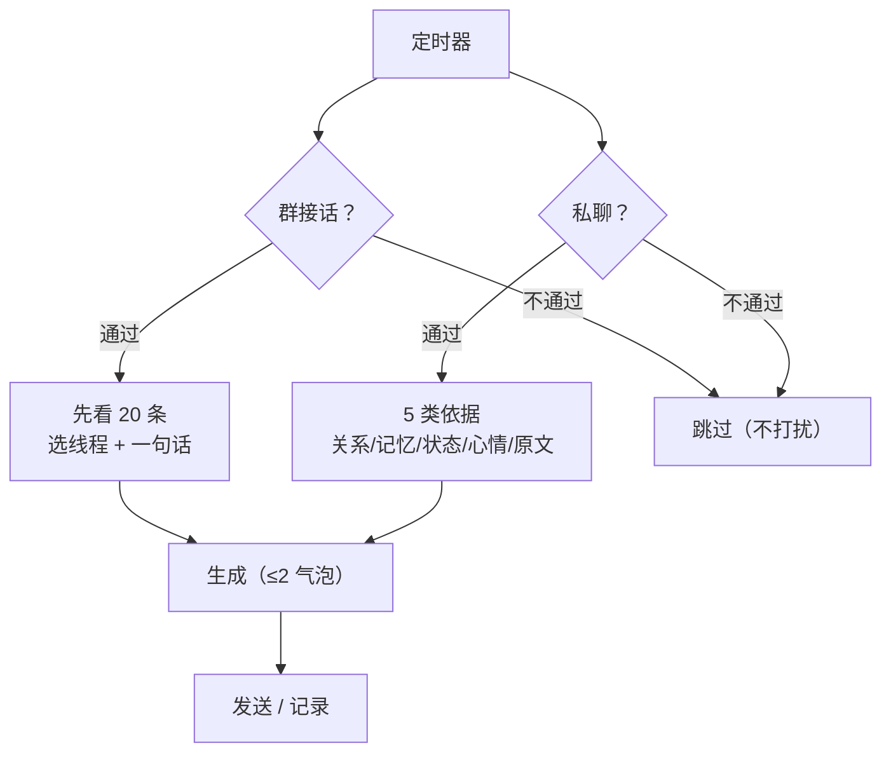

# 主动行为设计（v1）：群接话 / 私聊

> **导航**：[设计主文档](DESIGN.md) ｜ 相关：[情绪](emotion-dynamics-design.md) · [流水线](pipeline-map.md) · [收发件人](addressing-design.md) · [风格](style-white-moon-design.md)
> **本文回答**：她什么时候主动开口、找谁、说什么、怎么不打扰。
> **本文不回答**：回复道细节、检索算法。
> **数字以 [DESIGN §3](DESIGN.md) 与 `core/tuning.py` 为准。** 本文每个数都标了 tuning 键；**没有键的是目标值，尚未接线**。

---

## 0. 结论

1. **主动是独立车道**，不是「回复道加个定时器」：
   群接话、私聊两条，判据不同，混在一起必然互相干扰。
2. **驱动只有两个半**：心情（想不想说）+ 好感/亲近（想不想对他说）+ 节奏（今天活不活跃）。
3. **先看 20 条再开口**：主动不是固定句子，是「先翻完再决定说什么」。
4. **打扰有成本**：冷却、静默时段、刚聊完/太久没聊、最后一句是她说的，都要闸。
5. **群里不做私聊那套**：群接话看「当下热闹」，私聊看「关系和时间」。

### 0.1 现状 vs 目标（2026-11-25 对过代码）

| | 群接话 | 私聊 |
|---|---|---|
| 代码 | `plugins/chat._random_chat_loop` + `aura_logic.decide_group_reply` | `services/proactive.py` + `chat._proactive_private_loop` |
| 已跑 | ✅ 相关度 + 概率 + 闸门 | ✅ 打分 + 9 道硬闸 |
| 判据 | 硬闸 → 概率（已含 chatty/intimacy）→ 惯性放行；**不是** `group_score` 排序 | 就是 §2.3 的公式（已实现） |
| 缺口 | 无日上限、概率很快顶到 0.8 | 无 token 预算、无 accept 埋点 |

**本文两种语气**：`现状` = 代码今天在做的；`目标` = 还没写的。改代码前先看 §10 缺口表。

---

## 1. 两条车道

| | 群接话 | 私聊 |
|---|---|---|
| 触发 | 每 **15s** 扫白名单群（`_random_chat_loop`） | 每 **600s**（`PROACTIVE_CHECK_SEC`） |
| 判据 | 当下热闹 + 她插得上（相关度） | 关系 + 心情 + 时间（打分） |
| 目标 | 群里某个线程 | 某个人 |
| 频率 | ≤3 次/天/群（`PROACTIVE_GROUP_MAX_PER_DAY`，已接线）+ 冷却 180s + ≤6 次/小时 | ≤2 次/天/人（`PROACTIVE_MAX_PER_DAY`） |
| 失败 | 不发就行 | 不发就行 |



---

## 2. 打分：心情 + 好感

### 2.1 基础量

```text
# 现状（services/proactive.py + mood.mood_factors）
chatty = 1 + max(-0.8, v)                  # 线性，v∈[-1,1]；群会话再 × group_mood.chat_factor
warm   = 0.5 + 1.2 × intimacy              # 0.5~1.7，亲密度决定「想找」的底
rhythm = {off:1.0, subtle:0.9, active:1.0, scattered:1.05, wild:1.1}
# RHYTHM_*：只做 ±10% 微调；off = 不漂移，不是「不想说话」
aff_n  = (affinity + 1) / 2                # -1~1 → 0~1（只有 §2.2 的目标式用）

# 目标（未接线；a 档位**已接线**——`AROUSAL_LEVEL_*` 在 mood.update_ad 里用，
#        tuning.UNWIRED 已清空；但 a 仍**不进 chatty**，见 §1.5 G6）
chatty = sigmoid(1.0 × v + 1.0 × a − 0.5)
```

> `chatty` 现在是**线性**的（0.2~1.8），不是 sigmoid。
> 一期 `a`（arousal）只记录不参与（G6），所以 sigmoid 版先不接线。

### 2.2 群接话

**现状**（`decide_group_reply` + `_VIEW_FREQ`，`plugins/chat`）：

```text
① 硬闸（rand 固定传 0，这里不抽样）
   必回：@她 / 引用她 / 唤醒词
   否则：不在 01–08 静默 && 冷却 180s（RANDOM_CHAT_INTERVAL）
         && 近 1h ≤6 次 && 近 5min ≥3 条真人消息（RANDOM_CHAT_MIN_MSGS）
         && relevance ≥ 0.25（minRelevance；单群覆盖时改 0）

② 概率（_VIEW_FREQ，带惯性：刚连说过几句会自动衰减）
   base = 0.35(RANDOM_CHAT_PROB) × chatty × (0.6 + 0.8 × 近 5 位发言者里最大的 intimacy)   # 上限 1.0
   ext  = min(0.8, base × (1 + 4 × relevance))                            # minRelevance=0 时无加成
   放行 = _VIEW_FREQ.decide(ext, random())
```

其他闸门：刷屏刹车（120s 内她已说 8 条）/ 被嫌后静默 / `chat_switch`（群或最后发言人）/
最新一句是「某人 → 另一个群友」（conf≥0.5）/ 关注期 / worker 忙 / 队列非空 / 10s 内刚回过 /
同一段只看一次（`_interject_seen`）/ 群里 5min 没动静 / `GROUP_WATCH_MODE=lite` / `proactive.interject` 技能关。

> 群接话其实已经有 `chatty` 和 `intimacy`（在 `base` 里），**缺的是 affinity 和 rhythm**。
> 相关度到 0.5 时 `ext` 就顶到 0.8，真正限流靠冷却、每小时 6 次和惯性衰减。

**目标**（A1 再做，替换「概率抽样」为「打分排序」）：

```text
group_score = chatty × warm × (0.6 + 0.8×aff_n) × rhythm
```

### 2.3 私聊

**现状 = 目标**（`services/proactive.py::score_of`）：

```text
score = chatty × (0.5 + 1.2×intimacy) × rhythm × (1.0 + 0.8×affinity)
若 v ≤ −0.25 且 affinity ≥ 0.35：score ×= 1.15        # 心情差 + 好感高 → 更想找他倾诉
开口条件：score ≥ PROACTIVE_MIN_SCORE(0.9)
```

> 中性状态下 `1.0 × 1.1 × 1.0 × 1.0 = 1.1`，已经过线 ——
> **分数主要用来拦「心情很差」和「好感为负」，拦人靠下面的硬闸。**

硬闸（任一不过就不打扰）：静音（`chat_switch`）/ 当天次数 / 冷却 6h / 刚聊完 <2h /
太久没聊 >72h / 最后一句是她（12h 内不追）/ 不够熟（intimacy<0.45）/ 好感 ≤ −0.25 / 没有历史。

> 设计稿里曾写过 `0.4×aff + 0.3×trust + 0.2×loneliness + 0.1×recency`，
> 但 `trust` / `loneliness` / `recency` 都没有实现，**别按那个式子调参**。

---

## 3. 开口前看什么（不是固定句子）

### 3.1 群接话：先看 20 条

```text
① 最近 20 条（线程视图 + 谁→谁）      ← SCENE_WINDOW_MSGS=20
② 当前线程在聊什么（conv_state / scene summary）
③ 她插得上吗（话题相关 + 没被别人占着）
④ 心情允许吗（chatty）
→ 选一个线程，说一句「接得上但不抢戏」的话
```

### 3.2 私聊：5 类依据

| # | 依据 | 来源 | 代码 |
|---|---|---|---|
| 1 | 你俩的关系 | `profile` full（人/事/关系/她在他面前） | `render_card(max_len=320)` |
| 2 | 跟他有关的记忆 | `memory` top3（用最近一句真人消息当 query） | `memory_v2.recall` |
| 3 | 上次聊到哪 | `conv_state` | `conv_state.render` |
| 4 | 我现在的心情 | `state`（心情不好可以找他倾诉） | `mood.status_block` |
| 5 | 最近的原文 | `history` 最近 8 行 | `_send_proactive` 追加 |

所以同一个「主动找人」，对 A 撒娇、对 B 正经、对 C 吐槽——
因为关系、印象、她在他面前的样子都不一样。

---

## 4. 预算（目标，比回复道小）

| 块 | 上限 |
|---|---|
| persona + protocol | 400 + 180 |
| state | 100 |
| profile（简版） | 120 |
| 记忆 | 2 条 ≤120 |
| conv_state / 摘要 | 100 |
| 历史 | 100 |
| **合计** | **≈1.1k（1120）** |
| 生成 | ≤2.5s |
| 图书馆 | **不查**（主动不查世界知识） |

> **现状没有硬预算**：文本直接拼，靠 `card 320 字 + 记忆 3 条 + 最近 8 行×120 字` 自然封顶，
> 长对话时可能超过 1.1k。接预算是 §10 P4。

---

## 5. 打扰控制（硬闸）

| 闸 | 群 | 私聊 |
|---|---|---|
| 每天次数 | ≤3/群 `PROACTIVE_GROUP_MAX_PER_DAY`（已接线） | ≤2/人 `PROACTIVE_MAX_PER_DAY` |
| 冷却 | 180s `RANDOM_CHAT_INTERVAL`（可按群覆盖） | 6h `PROACTIVE_COOLDOWN_H` |
| 刚聊完 | 5min 内不足 3 条真人消息就不动 | <2h 不主动 `PROACTIVE_IDLE_MIN_H` |
| 太久没聊 | — | >72h **直接不找** `PROACTIVE_IDLE_MAX_H` |
| 最后一句是她 | 同一段只看一次 `_interject_seen` | 12h 内不再追 |
| 静默时段 | 01–08 `quietHours`（可按群覆盖） | 01–09 `PROACTIVE_QUIET_START/END` |
| 被嫌 / 冷淡 | 被嫌后静默 `_is_muted` | 好感 ≤ −0.25 不找 |
| 其他 | 关注期 / worker 忙 / 队列非空 / 10s 内回过 / 刷屏刹车 | 无历史不找 |

> 「>72h」在代码里是**硬闸**，不是设计稿原先写的「降权」。要不要改成降权，见 §10 P2。
> 被无视/被拒绝没有单独的 24h 计时，靠「最后一句是她 → 12h」和好感负值兜住。

---

## 6. 和回复道的关系

```text
主动车道只负责「触发 + 选目标 + 组一个更小的 prompt」；
生成、输出、判读仍然复用回复道。
```

**现状**：主动发出的消息只写 `dialogue_log`（kind=bot）+ 一条 `memory_v2`（kind=event, importance 0.55）。
`interaction_edges(kind=proactive)` **还没建**（表只在设计稿里），所以白月光/关系统计会漏掉她主动的那些 —— §10 P3。

主动消息**不参与**「已回 guard」（它不是回复某条），但参与「今天次数/冷却」。

---

## 7. 评测

| 指标 | 定义 | 目标 | 现状 |
|---|---|---|---|
| `accept_rate` | 主动后 10min 内对方回复的比例 | ≥40% | **未埋点** |
| `negative_rate` | 被无视/被嫌/被移出的比例 | ≤10% | **未埋点** |
| `daily_count` | 每天主动次数 | 群 ≤3，私聊 ≤2 | 私聊可算，群没有 |
| `repeat_target` | 连续 3 天找同一人的比例 | ≤30% | **未埋点** |
| `human_rating` | 人评「这句像不像她主动想说的」 | ≥3.5/5 | 人工 |

A/B：开/关主动各一周，比较群活跃度与负反馈。

> 要算 `accept_rate`，`mark_sent` 必须落一条 `sent_at`，并在下一轮真人消息到达时补 `accepted_at`。
> 现在只有 `mark_sent/mark_skipped`，指标是空话 —— §10 P5。

---

## 8. 分阶段

| 阶段 | 做什么 | 状态 | 验收 |
|---|---|---|---|
| A1 | 群接话：20 条视图 + chatty 打分 + 闸门 | 🟡 已跑「相关度+概率」，**打分未做** | 不刷屏；每天 ≤3 |
| A2 | 私聊：5 类依据 + 打分 + 冷却 | ✅ 已跑 | accept ≥40% |
| A3 | `interaction_edges(kind=proactive)` | ⬜ 未建 | 统计不漏 |
| A4 | A/B 一周 | ⬜ 未做 | negative ≤10% |

---

## 9. 明确不做

- 不在群里做「私聊式关心」（会显得奇怪）；
- 不在刚被拒绝后继续找；
- 不主动查图书馆（世界知识不是主动的理由）；
- 不用固定句子模板（必须先看 20 条/5 类依据）；
- 不把主动次数当 KPI（打扰率优先）。

---

## 10. 缺口清单（P1~P6，等拍板）

| # | 缺口 | 现状 | 建议 | 不修的后果 |
|---|---|---|---|---|
| P1 | 群没有日上限 | 只有 180s 冷却 + ≤6 次/小时 | 加 `GROUP_INTERJECT_MAX_PER_DAY=3`（按群落盘） | 活跃群一天能插 20+ 次 |
| P2 | 「太久没聊」是硬闸 | >72h 直接不找 | 二选一：改成降权（×0.5），或承认是硬闸 | 3 天没聊的人永远等不到她 |
| P3 | `interaction_edges` 未建 | 只写 dialogue_log / memory | 建表后补 `kind=proactive` | 白月光、社交图漏掉她的主动 |
| P4 | 主动 prompt 无 token 预算 | 文本直接拼 | 接 §4 的 1120 预算 | 长对话时比回复道还贵 |
| P5 | `accept_rate` 无埋点 | 只有 sent/skipped 计数 | 记 `sent_at` + 下条真人消息补 `accepted_at` | §7 验收全是空话 |
| P6 | 群接话不打分 | 概率 + 惯性衰减，无分数排序（rel 0.5 就顶到 0.8） | A1 换 `group_score` 排序 | 想说话时说不出来，不想说时瞎插 |
| P7 | 群插话有 4 个写死倍率 | `0.6 + 0.8×intimacy`、`1 + 4×rel`、上限 `0.8`、上限 `1.0` 都在 `chat` 里 | 收进 `GROUP_INTERJECT_*`（和 RHYTHM_* 一样） | 调参时找不到、改了也不生效 |
