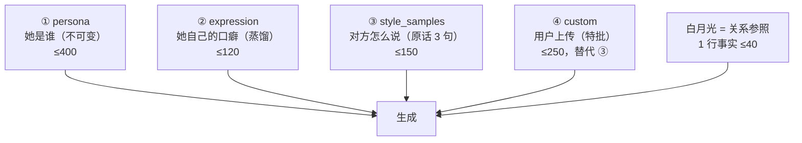

# 风格系统与白月光系统设计（v1）

> **导航**：[设计主文档](DESIGN.md) ｜ 相关：[收发件人](addressing-design.md) · [情绪](emotion-dynamics-design.md) · [注意力](attention-design.md) · [检索](retrieval-design.md)
> **本文回答**：风格/白月光现在是什么、定位该怎么改、放多少注意力、塞在链路哪里、参考什么。
> **本文不回答**：情绪公式、sqlite 表结构（见对应文档）。

---

## 0. 结论

1. **风格分四层**，不要再混成一个「风格块」：
   `persona（她是谁）` / `expression（她自己的口癖）` / `style_samples（对方怎么说）` / `custom（用户上传）`。
2. **白月光不是「借谁的风格」**，而是**「这个人以谁为参照」**（reference group）。
   默认只写一行事实；借风格必须显式开关 + 比例 + 人格护栏。
3. **注意力额度**：风格相关总量 **≤450 token**（占 2.2k 的 20%），其中原话样本 ≤150。
4. **不要重复注入**：档案块只写「说话习惯（蒸馏一句）」，原话样本只在 ⑧ 出现一次。
5. **风格也要能评**：像不像（fidelity）、还是不是她自己（persona consistency）、有没有过度模仿（over-accommodation）。

---

## 1. 现状（as-built）

### 1.1 三套东西

| 模块 | 存什么 | 怎么用 |
|---|---|---|
| `style_vault.corpus` | 每个人在群里说过的原话，最近 200 条 | `samples(gid,qq,3)` 取最近 3 句 |
| `style_vault.custom` | 用户上传的样本 + 审批（pending/approved） | 优先于白月光，最多 1200 字 |
| `expression` | LLM 蒸馏的短句（≤24 字，学口癖） | 省 token 用 |
| `white_moon` | A 最常 @/引用 谁 = A 的白月光；群级汇总 | 回 A 时借「A 的白月光」的说话方式 |

### 1.2 现在塞在哪

```text
③ 档案块：profile_note() → 「他的白月光是谁 + 说话方式：…」
⑧ 白月光块：render_style_only() → 风格摘要 + 3 句原话（或自定义 1200 字）
```

### 1.3 问题

| # | 问题 | 后果 |
|---|---|---|
| S1 | ③ 和 ⑧ 都写「白月光是谁/说话方式」 | 重复，token 浪费 |
| S2 | 自定义样本最多 1200 字 | 单块就吃掉一半预算 |
| S3 | 原话只按「最近」取 | 场景不匹配（安慰时用了吐槽语气） |
| S4 | 没有质量/安全过滤 | 可能学到骂人、广告、NSFW |
| S5 | 白月光语义是「借风格」 | 容易变成「模仿 A 喜欢的人」，不是她自己 |
| S6 | 没有人格护栏 | 冷漠人设借了高能量风格 → 出戏 |
| S7 | 没有评测 | 不知道「像不像」「过不过度」 |
| S8 | 原话长期保存，无保留策略 | 隐私风险 |

---

## 2. 定位：四层，各管一件事



| 层 | 回答 | 变化频率 | 注入策略 |
|---|---|---|---|
| persona | 她是谁 | 不变 | always |
| expression | 她平时怎么说话 | 周 | always（可关） |
| style_samples | **这个人**怎么说话 | 天 | 只在回这个人时 |
| custom | 用户自己给的样本 | 手动 | 最高优先，替代 ③ |
| white_moon | 这个人**以谁为参照** | 周 | 1 行事实；借风格另开关 |

**关键区分**：

- `expression` 是**她自己的**口癖（学自己，不是学别人）；
- `style_samples` 是**对方的**说话方式（学句式，不学内容）；
- `white_moon` 是**关系事实**（他常找谁），不是风格本身。

---

### 2.6 表达节奏（旧 `services/attention.py`，并入风格层）

> 命名注意：**这里说的是「表达节奏」**，不是 [attention-design.md](attention-design.md) 的「上下文预算」。
> 两者同名不同物，文档里统一叫「节奏（rhythm）」。

它解决的是：约束全是负向的（别总结/别抢话），回复会变得太老实，缺少「被一个细节勾走一下、再拐回来」的活气。

三个旋钮（纯风格：不参与心情/关系/记忆数值；`rhythm` 仅作自驱强度 ±10%）：

| 变量 | 取值 | 含义 |
|---|---|---|
| `ATTENTION_DRIFT` | subtle / active / scattered / wild / off | 漂移强度 |
| `ATTENTION_ANCHOR` | strict / balanced / loose | 回钩策略 |
| `ATTENTION_REACTION` | reserved / natural / lively | 短反应频率 |

默认 `active / balanced / natural`。输出一段 **≤40 token（4 行以内）** 的风格约束，放在**风格块之后、post_rules 之前**：

```text
▍表达节奏（风格，不是毛病）
· 可以被新鲜/好笑/反差强的细节短暂吸引，但每次都要能在最近消息里找到触发点
· 漂移 ≠ 换话题：先抓住那个点，用很短一句拐一下，再回到正在聊的事
· 每轮最多一次明显跳跃；别人明确在问什么，必须先答那个
· 不要自称分心、不提 ADHD、不说「我走神了」
```

硬约束（写死在每一档里）：

1. 每次漂移必须有触发点，不能凭空联想；
2. 漂移 ≠ 换话题；
3. 每轮最多一次明显跳跃；
4. 不能无视明确提问；
5. 不要自称分心（防止变成人设表演）。

它**不参与**心情/好感/记忆计算；只影响语气和句子走向。

---

## 3. 注意力：给多少、放哪里

| 块 | 上限 | 什么时候给 |
|---|---|---|
| persona | 400 | 总是（**人格区，不计入风格**） |
| expression | 120 | 总是（`STYLE_EXPRESSION=1`） |
| style_samples | 150（3 句 × ≤40 字 + 说明） | 回具体人、且无 custom |
| custom | 250 | 有 approved 时，**替代** style_samples |
| 表达节奏（rhythm） | 40 | 总是（`ATTENTION_DRIFT≠off`） |
| white_moon 事实 | 40（1 行） | 档案块里，总是 |
| white_moon 借风格 | 120 | 仅 `WHITE_MOON_BORROW=1` 且无 custom/style |
| **风格相关合计**（不含 persona） | **≤450**（常态 350；custom 450） | 占 2.2k 的 ~20% |

位置：

```text
system: persona + expression（她的底色）
档案块: 1 行「他说话习惯：短句/爱用问号/口头禅 X」+ 1 行白月光事实
⑧ 风格块: 3 句原话 + 「学句式，不学内容」（紧贴当前消息之前）
```

**禁止**：档案块里再贴原话；⑧ 再重复「白月光是谁」。

---

## 4. 白月光：从「借风格」改成「关系参照」

### 4.1 语义修正

旧：A 最常 @ B → 回 A 时**用 B 的说话方式**。
新：A 最常 @ B → **B 是 A 的参照系**。这解释的是「A 在意谁 / 会提谁 / 什么话题安全」，
不自动等于「她要学 B 说话」。

### 4.2 三个用途（按优先级）

| 用途 | 做法 | 例子 |
|---|---|---|
| **话题安全** | 提到 B 时看 A 的反应；B 在场时不抢「我和 B 更熟」 | A 的白月光是 B，B 在场 → 不调侃 A 和 B 的关系 |
| **安慰策略** | B 不在时，A 可能失落 → 用「陪」而不是「讲道理」 | 「他又没来？」→ 轻一点 |
| **语气参照** | 只在开关打开时借一点句式，比例 ≤0.5 | 借 B 的句长/标点，不借内容 |

### 4.3 借风格的三个护栏

```text
① 比例：borrow_ratio ∈ {0, 0.3, 0.5}，默认 0
② 人格：persona 冷/内敛（expressiveness<0.3）→ 上限 0.2；高能量样本降级
③ 反讽：不许把 B 的口癖用来嘲笑 A；不许「变成 B」——prompt 明确「别每句都用」
```

> ✅ **已接线（2026-11-25）**：`WHITE_MOON_BORROW`（默认 0，只给 1 行事实）、
> `WHITE_MOON_BORROW_RATIO`（夹到 0/0.3/0.5）、`WHITE_MOON_BORROW_COLD_MAX`、
> `PERSONA_EXPRESSIVENESS`；日志 `[MOON] borrow=… expr=…`。
> `custom` 层走 `style_vault.submit/approve`，上限 `CTX_CUSTOM=250` 字，优先于 samples。

### 4.4 数据来源：统一到 `interaction_edges`

优先聚合 `interaction_edges`（详见 addressing §3.3）；样本不足 `WHITE_MOON_MIN_SCORE`
时才回退到旧的 `white_moon.json` 计数器：

```sql
SELECT to_qq, COUNT(*) AS n
FROM interaction_edges
WHERE gid=? AND from_qq=? AND to_qq<>''
GROUP BY to_qq ORDER BY n DESC LIMIT 1;
```

好处：与收发件人同源，不会「白月光统计和现场对不上」。

---

## 5. 风格检索：按场景取，不按「最近」

### 5.1 `style_samples` 表

```sql
CREATE TABLE style_samples (
  id TEXT PRIMARY KEY,
  qq TEXT, gid TEXT,
  text TEXT,
  scene TEXT,          -- joke / comfort / info / tease / serious / any
  length_bucket TEXT,  -- short / mid / long
  emoji INTEGER,       -- 0/1
  quality REAL,        -- 0~1（规则 + 人工）
  approved INTEGER,    -- 0/1
  ts REAL
);
CREATE INDEX idx_style_pick ON style_samples(qq, gid, approved, scene, quality);
```

### 5.2 质量与安全（补 S4）

```text
quality = 0.3
        + 0.2×(长度在 8~60 字)
        + 0.2×(有标点/语气词)
        + 0.2×(不是命令/广告/链接)
        + 0.1×(无辱骂/NSFW)
        - 0.3×(纯复读/纯表情)
approved = 主人特批 或 (quality ≥0.6 且 无敏感词)
```

### 5.3 取 3 句：相关性 + 多样性（MMR）

```text
候选：同 qq + 同 gid + approved + scene 匹配（scene='any' 兜底）
排序：quality 0.5 + recency 0.3 + scene_match 0.2
MMR：λ=0.7，避免 3 句都是同一长度/同一语气
```

✅ 已实现（2026-11-25）：`services/mmr.py` 通用选择器；
`style_vault.samples(..., diverse=True)` 与 `memdb.style_samples_of()` 都走 MMR，
白月光 `_raw_examples()` 取 3 句时默认启用（`STYLE_MMR_*`）。

### 5.4 保留策略（补 S8）

```text
corpus 每人每群保留最近 200 条 / 90 天，超期删除
custom 由用户主动上传，可随时撤回
style_samples 只保留 approved 或 quality≥0.6
```

---

## 6. 参考：论文与哲学

### 6.1 语言学 / 传播学

| 理论 | 说什么 | 我们怎么用 |
|---|---|---|
| **Communication Accommodation Theory**（Giles） | 会向对方靠拢（convergence），但过度靠拢会被视为嘲弄 | `borrow_ratio` 上限 0.5；过度模仿检测 |
| **Audience Design**（Bell 1984） | 说话风格是**为听众设计**的 | 回 A 用 A 的 register；回群用群 register |
| **Register theory**（Halliday：field/tenor/mode） | 场景决定语域 | `scene` 标签：joke/comfort/info/serious |
| **Politeness Theory**（Brown & Levinson） | 面子威胁决定委婉程度 | 批评/拒绝时加 hedge，不用对方口癖 |
| **Bakhtin 双声语（double-voicing）** | 借别人声音说话是「双声」，容易变成戏仿 | prompt 明确「别变成他、别用来嘲讽」 |
| **Goffman footing** | 借声时立场会变 | 借风格只在「语气层」，立场仍是她自己 |

### 6.2 哲学

| 思想家 | 概念 | 用处 |
|---|---|---|
| **Aristotle《修辞学》** | `lexis`（风格）是修辞的一部分，要**适合说话人/听众/场合** | 风格不是越像越好，要 decorum |
| **Cicero《论演说家》** | `decorum`：得体 = 人、事、时、地匹配 | persona guard + scene 匹配 |
| **孔子「正名」** | 称呼要正 | 称呼系统（callname）优先于风格 |
| **Hume《论品味》** | 品味有标准，但受情境影响 | 风格好坏要人评，不只看相似度 |

### 6.3 社会心理

| 理论 | 用处 |
|---|---|
| **Merton 参照群体理论** | 白月光 = reference group，不是模仿对象 |
| **依恋迁移（attachment transference）** | A 的白月光可能是依恋对象 → 决定安慰策略 |
| **社会网络三角闭合** | A-B 关系影响她能否提 B（避免尴尬） |

---

## 7. 评测：三个指标

| 指标 | 怎么测 | 目标 |
|---|---|---|
| `style_fidelity` | 人评 1~5：「像不像这个人的说话方式」 | ≥3.5 |
| `persona_consistency` | 人评 1~5：「还是不是她自己」 | ≥4.0 |
| `over_accommodation` | 人评/规则：有没有变成嘲弄/复读 | ≤10% |
| `style_tokens` | 每轮风格相关 token | ≤450 |
| A/B | 有/无风格块各 20 条，盲评偏好 | 有风格 ≥60% 偏好 |

---

## 8. 链路怎么塞（最终形态）

```text
④ 取数：
  · 档案块：1 行「说话习惯（蒸馏）」+ 1 行「白月光事实」
  · 风格块：custom（若有）或 style_samples 3 句
⑤ 生成：
  · system 里放 persona + expression
  · 风格块紧贴当前消息之前（近因）
⑥ 输出：
  · 不因为借风格而改立场/称呼
⑦ 判读：
  · 风格不参与情绪归因（风格是表达层，不是事件层）
```

**和情绪的关系**：风格只影响「怎么说」，不影响「怎么感受」。
不要把「借了谁的口癖」写进心情/好感。

---

## 9. 分阶段

| 阶段 | 做什么 | 验收 |
|---|---|---|
| W0 | 去掉重复：档案只留蒸馏一句，⑧ 只留样本 | token 降 ≥300/轮 |
| W1 | `style_samples` 表 + scene/quality/approved | 3 句里至少 2 句场景匹配 |
| W2 | custom 从 1200 降到 250，替代样本 | 不再挤占预算 |
| W3 | 白月光改「关系参照」+ `borrow_ratio` + 人格护栏 | 「变成别人」评分 ≤2/5 |
| W4 | `interaction_edges` 聚合替代 `white_moon.json` | 统计与现场一致 |
| W5 | 20 条盲评 A/B | fidelity ≥3.5，consistency ≥4.0 |
